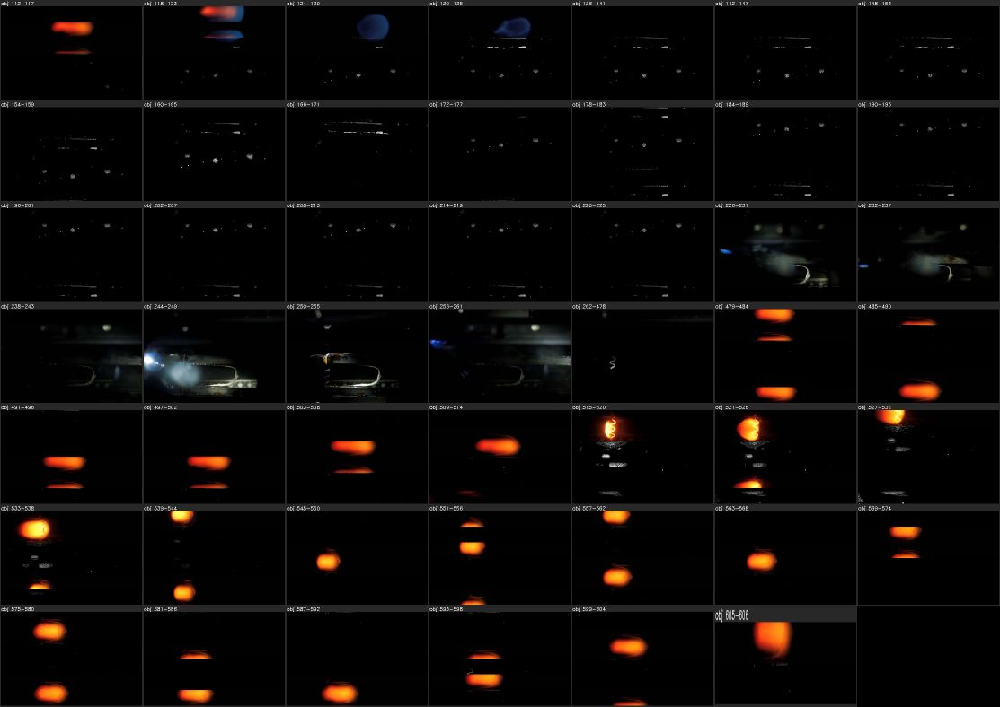
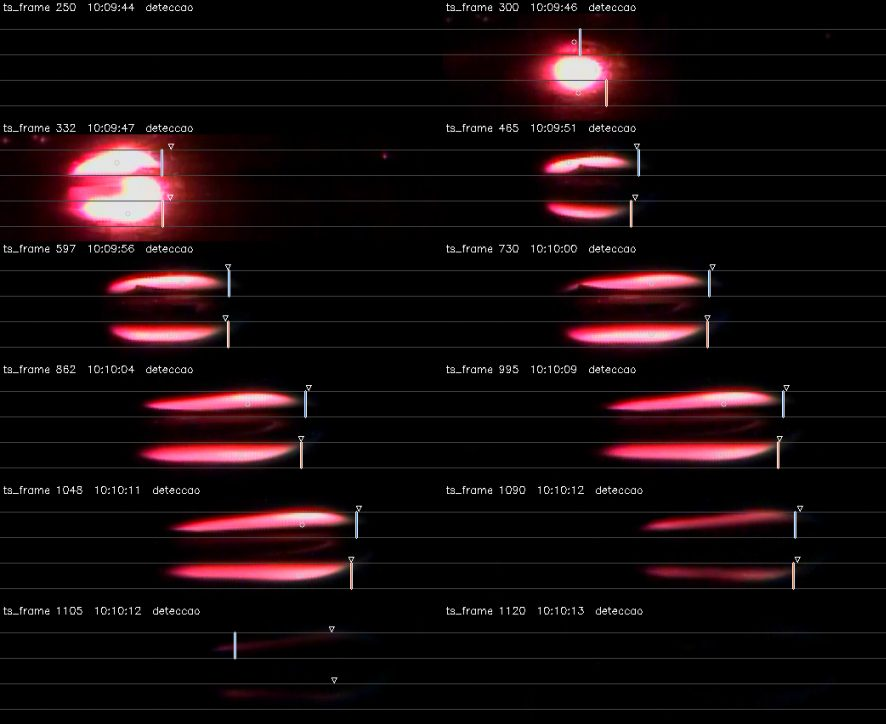
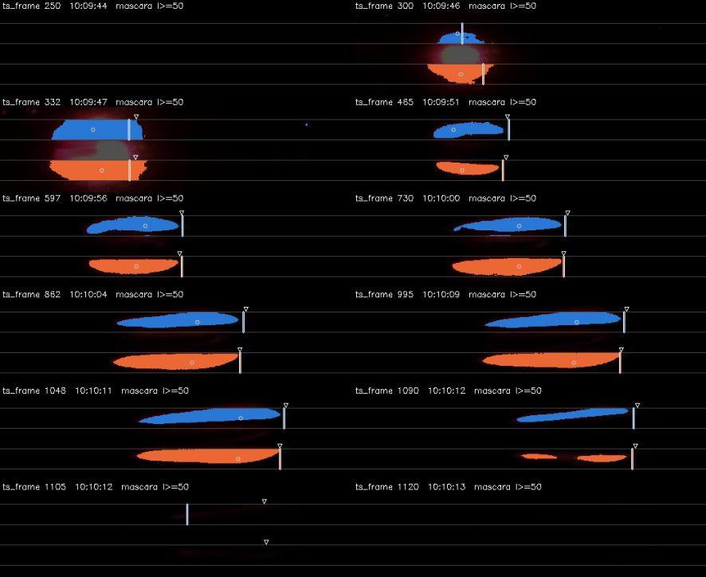
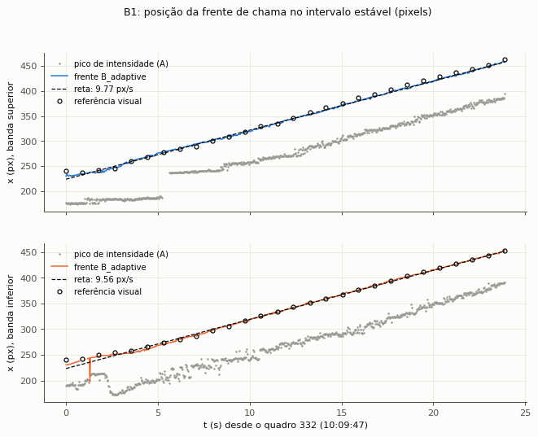
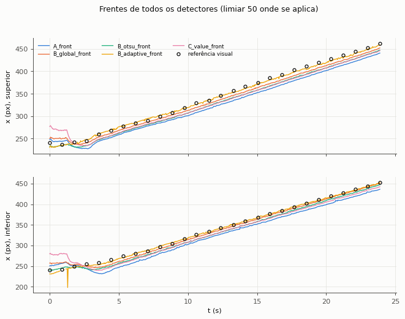
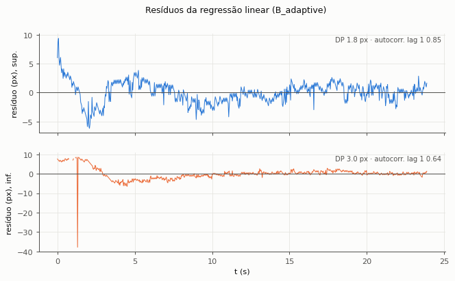
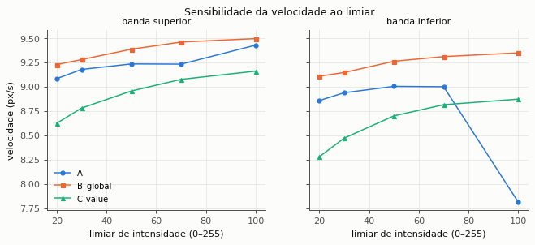
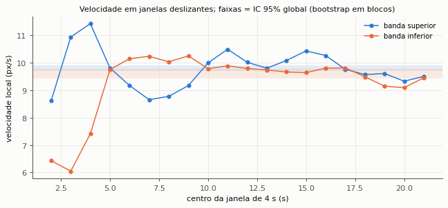
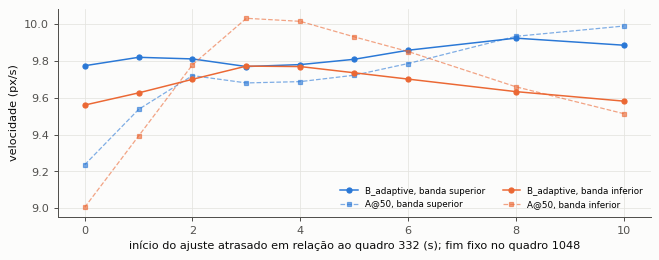

# BASS-II (PSI-25) — teste B1: detecção e rastreamento da frente de chama (pixels)

Fase P3 do ramo `feat/bass2-propagation`. Este relatório parte de [BASS2_B1_TIMEBASE_AND_TELEMETRY.md](BASS2_B1_TIMEBASE_AND_TELEMETRY.md) (base temporal e regimes) e de [BASS2_B1_SPATIAL_CALIBRATION.md](BASS2_B1_SPATIAL_CALIBRATION.md) (calibração `insufficient`). Todas as posições estão em pixels e todas as velocidades em px/s.

Marcadores usados no texto:

- **[Medição]**: lido diretamente dos arquivos ou dos vídeos.
- **[Resultado computacional]**: saída dos scripts desta fase.
- **[Referência visual]**: anotação manual. Neste conjunto ela foi feita pelo assistente de IA, que leu pranchas ampliadas; não há anotação de especialista humano (ver §8).
- **[NASA]**: valor ou método publicado.
- **[Inferência]**: conclusão tirada dos dados.
- **[Hipótese]**: explicação plausível ainda não verificada.

## Produtos

| Tipo | Arquivo | Conteúdo |
|---|---|---|
| Configuração | [data/bass2/b1/flamefront-config.json](../../data/bass2/b1/flamefront-config.json) | ROIs, janelas, limiares, parâmetros de rastreamento, bootstrap e sensibilidade |
| Script | [scripts/bass2/segment_b1.py](../../scripts/bass2/segment_b1.py) | Detectores A, B e C, por banda e por quadro |
| Script | [scripts/bass2/track_b1.py](../../scripts/bass2/track_b1.py) | Rastreamento com porta (gate), sem monotonicidade nem interpolação |
| Script | [scripts/bass2/analyze_b1.py](../../scripts/bass2/analyze_b1.py) | Regressão, bootstrap em blocos, sensibilidade, comparação com a referência, figuras e vídeo |
| Script | [scripts/bass2/annotate_b1.py](../../scripts/bass2/annotate_b1.py) | Seleção de quadros, pranchas de anotação, modo interativo, validação do CSV |
| Dados | [data/bass2/b1/flamefront-observations.csv](../../data/bass2/b1/flamefront-observations.csv) | 1 313 quadros × 2 bandas × 6 detectores (1,0 MB) |
| Dados | [data/bass2/b1/flamefront-tracks.csv](../../data/bass2/b1/flamefront-tracks.csv) | 7 séries rastreadas × 2 bandas × 1 313 quadros (1,2 MB) |
| Dados | [data/bass2/b1/flamefront-pixel.json](../../data/bass2/b1/flamefront-pixel.json) | Todos os ajustes, intervalos, sensibilidades e o estado da comparação com a NASA |
| Referência | [data/bass2/b1/annotations/b1-manual-annotations.csv](../../data/bass2/b1/annotations/b1-manual-annotations.csv) | 32 quadros × 2 bandas, com anotador, método e observações |
| Modelo | [data/bass2/b1/annotations/b1-annotation-template.csv](../../data/bass2/b1/annotations/b1-annotation-template.csv) | Os mesmos 32 quadros vazios, para uma anotação humana independente |
| Testes | `scripts/bass2/test_segmentation_b1.py`, `test_tracking_b1.py`, `test_analysis_b1.py` | 44 testes novos (§15) |
| Figuras | `docs/research/img/bass2_b1/flamefront-*.png\|jpg`, `proofsheet-strips.jpg` | Cópias reduzidas |
| Cache (fora do Git) | `data/cache/bass2/previews/b1/` | Pranchas de anotação, figuras em resolução maior, `diagnostic-b1.mp4` (871 quadros, 520×142, 30 fps) e tiras do ProofSheet |

Reprodução, nesta ordem: `segment_b1.py` (≈ 6 s), `track_b1.py`, `analyze_b1.py` (≈ 60 s). O comando `annotate_b1.py prepare` só é necessário para gerar novas pranchas.

---

## 1. Resumo executivo

- **[Resultado computacional]** As duas lâminas luminosas do B1 avançam em +x de forma aproximadamente linear durante o intervalo estável. São os quadros 332–1048 do TS, das 10:09:47 às 10:10:11, num total de 23,88 s.
- A definição de frente escolhida pela regra da §6 é a **segmentação adaptativa (B_adaptive)**. Com ela, a velocidade da lâmina superior é **9,77 px/s (IC 95%: 9,70–9,90)** e a da inferior é **9,56 px/s (IC 95%: 9,43–9,79)**. Os intervalos vêm de bootstrap em blocos de 1 s. O R² é 0,9993 na lâmina superior e 0,9978 na inferior.
- A incerteza dominante é **sistemática, não estatística**. Na janela inteira, as 16 definições de frente elegíveis dão 8,62–9,77 px/s na lâmina superior e 8,28–9,56 px/s na inferior.
  - A dispersão vem quase toda dos primeiros ~3 s. Nesse trecho, o brilho residual da ignição ainda domina a extremidade luminosa e as frentes por limiar chegam a recuar.
  - Na segunda metade da janela, as mesmas 16 definições convergem: **9,81–9,99 px/s na lâmina superior e 9,27–10,01 px/s na inferior**.
- **[Referência visual]** A reta ajustada aos 28 quadros de referência no intervalo estável dá 9,92 px/s na lâmina superior e 9,35 px/s na inferior. Contra essa referência, a frente B_adaptive tem MAE de 3,4 px na lâmina superior e 1,9 px na inferior, com viés de −2,6 e −1,6 px.
- **[Medição]** Repetir a detecção no MP4 do PSI em vez do TS original não muda a velocidade (método A: diferença ≤ 0,004 px/s). O deslocamento de 30 quadros encontrado na P2 está confirmado.
- **[NASA]** A velocidade publicada é 2,2 mm/s. Não há conversão nem comparação: o estado é **`blocked_spatial_calibration`**, porque não existe escala validada (§4 e §14).

## 2. Fontes de vídeo utilizadas

| Fonte | Uso | Identificação |
|---|---|---|
| `BASS_GMT50_SAMPLE_147_TEST_B1.ts` (do ZIP de vídeos originais) | Fonte principal de todas as detecções | sha256 `8ab341de…33fbd8d`, 1 313 quadros decodificáveis |
| `PSI-25_Raw Data_BASS_GMT50_SAMPLE_147_TEST_B1.mp4` | Alternativa (`fallback` da configuração) e verificação da fonte (§11.5) | sha256 `e82f6426…584d273cd`, 1 343 quadros |
| `…_TPB1_ProofSheet.pdf` | Investigação geométrica (§4) | 264 402 bytes, sha256 `408e80af0e46cb95…`. Baixado com autorização, pois é menor que 1 MB |

- **Convenção de índice [Medição]:**
  - `ts_frame` é o índice do quadro decodificável do TS. O quadro 0 é o primeiro decodificável, com PTS relativo de 0,167 s.
  - No MP4 do PSI, `mp4_frame = ts_frame + 30` (`timebase.json`, `mp4ToTs.offsetFrames`).
  - `segment_b1.resolve_source` ([segment_b1.py:81](../../scripts/bass2/segment_b1.py#L81)) confere o hash do TS. Se ele faltar, usa o MP4 descartando os 30 quadros iniciais ([segment_b1.py:97](../../scripts/bass2/segment_b1.py#L97)).
  - `segment_b1.main` recusa a execução se o número de quadros decodificados diferir do de `timebase-frames.csv`.
- **Tempo:**
  - Toda regressão usa `timestamp_experiment_fit_s`, a reta do relógio da P2: relógio = 36576,143 + 0,99955·(t_vídeo − 0,167).
  - Em cada série, o tempo é medido a partir do quadro 332 (36587,215 s).
  - O PTS do TS tem passos de 33 e 34 ms e um passo de 67 ms. Por isso as regressões usam o tempo de cada quadro, e não o índice.
- **Janela [Medição]:** a conferência com a P2 confirma os limites (`flamefront-pixel.json`, `window`).
  - Quadro 332 → 10:09:47 (36587,215 s).
  - Quadro 1048 → 10:10:11 (36611,094 s).
  - São 717 quadros, com intervalo mediano de 0,0334 s.

## 3. Sistema de coordenadas e ROIs

Todas as definições estão em [flamefront-config.json](../../data/bass2/b1/flamefront-config.json); nenhum valor está fixo no código.

- **Coordenadas:**
  - A origem é o canto superior esquerdo do quadro 720×480.
  - x cresce para a direita e y para baixo.
  - A propagação é no eixo x com sinal +1. A frente é a extremidade da emissão em +x, a montante do fluxo oposto.
  - **[Medição]** A extremidade direita avança para x maior durante todo o intervalo estável.
  - **[NASA]** O relatório descreve o fluxo da direita para a esquerda e a ignição na ponta esquerda (Summary Report, PDF p. 29).

| Região | x | y | Uso |
|---|---|---|---|
| overlay | 0–719 | 0–89 | Excluída (telemetria sobreposta) |
| flame | 40–560 | 230–355 | Contém as duas lâminas e o ignitor |
| banda `upper` | 40–560 | 248–278 | Lâmina superior (pico médio em y≈262) |
| banda `lower` | 40–560 | 308–338 | Lâmina inferior (pico médio em y≈322) |
| gap | — | 284–302 | Faixa escura entre as lâminas, não usada |
| ignitor | 60–240 | 230–355 | Brilho saturado nos quadros 280–331 |
| background | 580–715 | 380–470 | Ruído do fundo |

- **[Medição]** O fundo é praticamente preto.
  - Média de 0,006 e desvio de 0,23 em níveis 0–255 no quadro 100.
  - O máximo do perfil de banda antes da ignição (quadros 0–275) é < 0,33. Nos quadros 1150–1310 é < 0,66.
  - Os picos do perfil no intervalo estável ficam entre 112 e 119 na lâmina superior e entre 71 e 121 na inferior.
- `validate_config` ([segment_b1.py:52](../../scripts/bass2/segment_b1.py#L52)) recusa:
  - regiões fora do quadro;
  - regiões que invadem a sobreposição;
  - bandas fora da região da chama;
  - bandas sobrepostas;
  - sinal de propagação diferente de ±1.
- **Unidade de x:** colunas da imagem. O aspecto do pixel do TS não é conhecido (o MP4 declara 10:11). Nada aqui depende disso, porque só se mede ao longo de x.

## 4. Investigação geométrica e escala física

Última tentativa de encontrar uma escala, feita antes da segmentação. **Conclusão: a calibração continua `insufficient`. [Medição/Inferência]**

| Pergunta | Resposta | Natureza |
|---|---|---|
| O comprimento de ~95 mm da amostra é reconhecível no vídeo? | Não. A lâmina luminosa não tem extremidades físicas visíveis: a ponta de montante é a própria frente e a de jusante apaga à medida que o filme é consumido | Medição |
| As extremidades da amostra ou do porta-amostra aparecem iluminadas? | Não. Fora da chama, a cena é preta. O brilho da ignição ilumina apenas a região do ignitor (P2, `ignition-lit-structures.jpg`) | Medição |
| O porta-amostra ou o ignitor têm dimensões documentadas? | Não há dimensões do gancho do ignitor nem do porta-amostra em nenhum documento baixado | Medição |
| O ZIP de originais traz mais alguma coisa? | Só os dois `.ts` (vídeo e Still_Sequence) | Medição |
| O TS original tem mais informação que o MP4? | Só os PTS. A imagem é a mesma (PSNR de 49 dB na P2) e as frentes coincidem (§11.5) | Medição |
| O ProofSheet ajuda? | Não para escala (ver abaixo) | Medição |

**ProofSheet do B1 [Medição]:**

- O PDF tem 54 miniaturas de vista de topo, cada uma com 314 px de largura e partida em faixas de 314×35 px.
- O PDF não traz as fotos em resolução útil. A reconstrução por ordem de objeto ([proofsheet-strips.jpg](img/bass2_b1/proofsheet-strips.jpg)) mistura faixas de fotos diferentes, então a ordem não é garantida.
- As fotos de chama mostram a lâmina vista de cima, em laranja. As seis fotos pós-queima (10:06:35–10:07:26) mostram o porta-amostra e o gancho do ignitor, sem régua nem dimensão documentada.
- Faixa de horários: 10:03:42–10:04:33, mais as seis fotos pós-queima. O contador da câmera indica 57 quadros, e o primeiro arquivo é `iss038e051066`.
- **A nota "(Date/Time is minus 1 day 6 min 10 sec from BASS Video Clock)" diverge em ~8 s do que foi observado.**
  - A foto 11 (10:03:43) já mostra o ignitor aceso, e o vídeo mostra luz às 10:09:45,4. Isso dá uma diferença de ≈ 6 min 2 s, coerente com a P2.
  - **[Inferência]** A nota é aproximada ou se refere a outro sincronismo. Para o B1, prevalece a medição da P2.



**Por que nenhuma das opções serve como escala:**

- A largura nominal de 20 mm fica na linha de visada do vídeo lateral.
- As fotos de topo não compartilham nenhum ponto identificável com o vídeo.
- Os 2,2 mm/s publicados tornariam qualquer validação circular, além de seu uso ser proibido nesta fase.

**`registration.json` permanece `insufficient`, e `calibrate_b1.to_mm` continua recusando a conversão.**

## 5. Metodologias de segmentação avaliadas

Todas operam por banda, sobre a luminância Rec.601 (`cv2.COLOR_BGR2GRAY`, equivalente ao `rgb2gray` do MATLAB). Os limiares variam de 20 a 100.

| Código | Família | Definição da frente | Função |
|---|---|---|---|
| A | Perfil de intensidade (adaptação do método NASA) | Média das linhas da banda e suavização de 5 px dão I(x). A frente é a última coluna com I ≥ T contada a partir do pico em +x, com cruzamento subpixel. O pico é o argmax de I(x) | `profile_front` [segment_b1.py:155](../../scripts/bass2/segment_b1.py#L155), `band_profile` [:126](../../scripts/bass2/segment_b1.py#L126) |
| B_global | Segmentação, limiar global | Máscara I ≥ T, abertura 3×3, componente conexo que contém o pixel mais brilhante; a frente é a coluna mais à direita desse componente | `segment_band` [segment_b1.py:188](../../scripts/bass2/segment_b1.py#L188) |
| B_otsu | Segmentação, Otsu | Igual a B_global, com o limiar escolhido por Otsu em cada quadro e banda | idem |
| B_adaptive | Segmentação, limiar adaptativo | Pixel acima da média local (bloco de 31 px) + 10 e acima de T/2 = 25; abertura; componente do pixel mais brilhante | idem |
| C_value | Cor (HSV) | Perfil de V = max(B, G, R), tratado como no método A | `colour_fronts` [segment_b1.py:235](../../scripts/bass2/segment_b1.py#L235) |
| C_blue | Cor (emissão azul) | Coluna mais à direita com pelo menos 2 pixels em que B ≥ 25 e B > 1,1·R | idem |

- **Regras comuns:**
  - Uma frente a menos de 3 px da borda da ROI é recusada (`frente no limite da ROI`).
  - A ausência de detecção vira NaN com motivo (`pico abaixo do limiar`, `nenhum componente acima do limiar`, `sem emissão azul dominante`, …). Nada é preenchido com zero.
  - `detect_frame` ([segment_b1.py:260](../../scripts/bass2/segment_b1.py#L260)) aplica tudo a uma banda.
  - Os parâmetros `band_shift` e `half_width_delta` servem ao estudo de sensibilidade de ROI.

## 6. Algoritmo selecionado e justificativa

**Regra, fixada no código antes de olhar as velocidades** ([analyze_b1.py:375](../../scripts/bass2/analyze_b1.py#L375)):

1. São candidatos A, B_global e C_value em cada limiar (20/30/50/70/100), mais B_otsu e B_adaptive. Isso dá 17 definições.
2. É elegível o candidato com cobertura ≥ 95% no intervalo estável nas duas bandas. Só A@100 fica de fora: tem 83,7% de cobertura na banda inferior, cujo pico mínimo é ≈ 71.
3. Escolhe-se o elegível com o menor MAE médio em relação à referência visual (§8).

**Resultado [Resultado computacional]:** **B_adaptive** (MAE médio de 2,68 px), seguido de B_global@30 (4,96 px), B_global@20 (6,41 px), B_global@50 (7,50 px) e A@20 (8,83 px). O ranking completo está em `flamefront-pixel.json`, em `primary.selection`.

**Justificativas além do MAE:**

- **[Resultado computacional]** B_adaptive tem o menor resíduo da reta: 1,84 px na lâmina superior e 3,04 px na inferior, contra 6,9 e 11,0 px do A@50.
- Tem também a menor variação entre janelas locais (CV de 7,5% e 13%) e a menor variação quando o início do ajuste é atrasado (§12).
- **[Inferência]** O método reage ao contraste local em vez de um nível absoluto. Por isso é menos afetado pelo brilho difuso da ignição, que domina os primeiros ~3 s.
- **Ressalva importante:** a regra usa uma referência que **não é independente nem de especialista** (§8). A escolha de B_adaptive é provisória. A velocidade não depende criticamente dela: na segunda metade da janela, todas as definições dão entre 9,3 e 10,0 px/s (§11).
- **[Inferência]** O pico (A_peak) não serve como frente.
  - Fica 64–80 px atrás da extremidade luminosa.
  - Até o quadro ≈ 495, na lâmina superior, ele está no brilho residual do ignitor (x ≈ 175–190).
  - Depois salta ~47 px para dentro da chama, o que exigiu reaquisição no rastreador.
  - A_peak é reportado separadamente, como pede o escopo.

**Limiar primário de A, B_global e C_value: 50.** É o limiar das séries gravadas em `flamefront-observations.csv` e `flamefront-tracks.csv`.

- Está bem acima do ruído (< 1) e abaixo do menor pico da banda inferior no intervalo estável (≈ 71). Com isso, as duas bandas têm cobertura completa.
- Os valores 30 e 70 da NASA vêm de fotos de topo e não se transferem. O estudo da §11 mostra que, entre 20 e 70, a velocidade varia pouco e o viés de posição varia muito.

## 7. Resultados da segmentação

**[Resultado computacional]** Presença de detecção por detector em todo o vídeo, `flamefront-observations.csv`:

| Detector | Superior: quadros com frente (1º–último) | Inferior: quadros com frente (1º–último) |
|---|---|---|
| A@50 | 789 (298–1086) | 784 (298–1081) |
| B_global@50 | 805 (297–1101) | 802 (293–1094) |
| B_otsu | 817 (292–1108) | 818 (288–1105) |
| B_adaptive | 811 (296–1106) | 813 (291–1103) |
| C_value@50 | 802 (297–1098) | 800 (294–1093) |
| C_blue | 333 (313–1039) | 566 (335–1092) |

- No intervalo estável, todos os detectores, exceto C_blue, dão frente em 717 de 717 quadros nas duas bandas.
- C_blue é ruidoso: no quadro 332 aponta x = 495, que é ruído cromático. Tem cobertura de 34% e 71% nas duas bandas.
- **[Inferência]** A ponta azulada existe, mas é fraca demais para uma medição autônoma nesta compressão.

Pranchas de diagnóstico, antes, durante e depois:

- Na prancha de detecções, a linha vertical é a frente B_adaptive, o círculo é o pico de A e o triângulo é a referência visual.
- Na prancha de máscaras, as regiões coloridas são os pixels com I ≥ 50 em cada banda.





**[Medição]** O que as pranchas mostram:

- **Quadro 250:** a cena está escura e nenhum detector dispara.
- **Quadros 300 e 332:** o brilho saturado da ignição forma uma mancha em "C" que cobre as duas bandas. Ali as frentes marcam a borda da mancha, não a ponta da chama.
- **Quadros 465–1048:** as duas lâminas estão bem separadas e avançam.
- **Quadros 1090–1105:** na rampa do FAN, a emissão enfraquece e os detectores por limiar perdem a lâmina antes do olho. Em 1105, B_adaptive na lâmina superior pega um resto em x ≈ 316, longe da referência.
- **Quadro 1120:** sem emissão; nenhum detector dispara.

## 8. Validação contra anotações manuais

**Natureza da referência [Referência visual]:**

- `b1-manual-annotations.csv` tem 32 quadros: 28 igualmente espaçados em 332–1048 (`numpy.linspace`) e 1070, 1090, 1105 e 1120.
- **Foram anotados pelo assistente de IA (Claude)**, por leitura visual de pranchas 3× com grade de 10 px (`annotator = claude-assistente`).
- **Não são anotações de especialista humano nem verdade de campo.**
- **Mitigação do viés:** as pranchas mostram o quadro sem ganho e sem nenhuma saída de detector (`annotate_b1.render`, [annotate_b1.py:42](../../scripts/bass2/annotate_b1.py#L42)). As 32 leituras foram gravadas **antes** de qualquer detector ser executado.
- **Critério:** x onde termina a emissão visível em +x, incluindo a ponta azulada fraca e excluindo o halo difuso. Precisão estimada em ±4 px.
- O quadro 1120 foi marcado como sem chama visível nas duas bandas.
- Nos quadros 332 e 359, a chama ainda está ligada ao brilho da ignição e a frente é difusa.
- **Recomendação:** um anotador humano deve refazer as 32 leituras a partir de `b1-annotation-template.csv`, com `annotate_b1.py interactive --annotator <nome>` (requer backend gráfico do matplotlib) ou preenchendo o CSV a partir das pranchas. Depois, basta rodar de novo `analyze_b1.py`.

**Métricas no intervalo estável [Resultado computacional]** (`compare_with_reference`, [analyze_b1.py:193](../../scripts/bass2/analyze_b1.py#L193)), sobre as séries rastreadas de `flamefront-tracks.csv` (limiar 50). As colunas significam:

- **cobertura:** fração dos quadros com referência visível que têm posição rastreada;
- **rejeição:** fração em que o detector achou algo, mas a porta rejeitou;
- **viés:** automático − referência.

| Banda | Série | n | MAE (px) | RMSE (px) | Viés (px) | Máx (px) | Cobertura | Rejeição |
|---|---|---|---|---|---|---|---|---|
| sup. | A_front@50 | 28 | 18,8 | — | −17,8 | 25,4 | 100% | 0% |
| sup. | A_peak | 27 | 67,7 | — | −67,7 | 80 | 96% | 3,6% |
| sup. | B_global@50 | 28 | 9,3 | — | −7,8 | 14 | 100% | 0% |
| sup. | B_otsu | 28 | 14,0 | — | −14,0 | 19 | 100% | 0% |
| sup. | **B_adaptive** | 28 | **3,4** | **4,2** | **−2,6** | **11** | 100% | 0% |
| sup. | C_value@50 | 28 | 15,7 | — | −10,9 | 35,7 | 100% | 0% |
| sup. | C_blue | 12 | 34,9 | — | +9,1 | 254 | 43% | 3,6% |
| inf. | A_front@50 | 28 | 16,3 | — | −14,5 | 26,9 | 100% | 0% |
| inf. | A_peak | 28 | 66,0 | — | −66,0 | 82 | 100% | 0% |
| inf. | B_global@50 | 28 | 5,7 | — | −3,1 | 17 | 100% | 0% |
| inf. | B_otsu | 28 | 8,9 | — | −8,7 | 16 | 100% | 0% |
| inf. | **B_adaptive** | 27 | **1,9** | **2,7** | **−1,6** | **9** | 96% | 3,6% |
| inf. | C_value@50 | 28 | 13,2 | — | −7,2 | 39,7 | 100% | 0% |
| inf. | C_blue | 20 | 7,5 | — | +3,9 | 21 | 71% | 3,6% |

O RMSE de todas as séries está em `flamefront-pixel.json` (`trackedSeries.<banda>.<série>.reference`).

**Viés de A em função do limiar [Resultado computacional]:**

- Lâmina superior: −6,3 / −10,9 / −17,8 / −24,5 / −40,7 px para T = 20 / 30 / 50 / 70 / 100.
- Lâmina inferior: −1,2 / −6,3 / −14,5 / −22,7 / −35,7 px.
- **[Inferência]** O perfil médio da banda cai gradualmente na ponta. Quanto maior o limiar, mais atrás da emissão visível fica a frente. É um deslocamento quase constante, que muda a posição e quase não muda a velocidade (§11).

**Quadros da rampa do FAN** (1070, 1090 e 1105 com referência visível; 1120 sem chama):

- Cobertura de A@50: 1 de 3. B_adaptive: 2 de 3, com MAE de 6 px na lâmina superior e 3 px na inferior.
- Nenhum detector dá falso positivo em 1120.
- **[Inferência]** Depois de 1048, a chama escurece mais rápido do que os limiares acompanham. Esse trecho não entra na estimativa de velocidade.

**Reta da própria referência [Referência visual + Resultado computacional]:** a referência é independente dos detectores, mas o espaçamento de ~0,9 s, os 28 pontos e o erro de leitura tornam o IC ingênuo apenas indicativo.

| Banda | Velocidade (px/s) | IC 95% ingênuo (t de Student) | R² | DP dos resíduos (px) |
|---|---|---|---|---|
| superior | 9,92 | 9,69–10,14 | 0,9968 | 4,1 |
| inferior | 9,35 | 9,13–9,57 | 0,9967 | 4,0 |

## 9. Rastreamento das duas regiões luminosas

O rastreamento fica em `gate_track` ([track_b1.py:52](../../scripts/bass2/track_b1.py#L52)), aplicado a cada banda e a cada série de forma independente.

- **Porta:** a posição é aceita se estiver a ≤ 40 px da mediana das últimas 15 posições aceitas.
- **Semente:** a referência inicial vem de 3 detecções consecutivas mutuamente coerentes.
- **Reaquisição** ([track_b1.py:74](../../scripts/bass2/track_b1.py#L74)):
  - Se 15 detecções seguidas forem rejeitadas e as 3 últimas concordarem entre si, a referência é reiniciada nelas, com o flag `reaquisicao`.
  - Foi necessária porque, sem ela, o pico da lâmina superior ficava preso ao brilho do ignitor depois do salto do quadro ≈ 495, com 560 rejeições.
- **Não há restrição de monotonicidade:** um recuo real da frente permanece nos dados (teste `test_a_real_recession_is_kept_no_monotonic_constraint`).
- **Não há interpolação:** quadros ausentes ou rejeitados ficam vazios em `tracked_px`.
- `smoothed_px` é uma mediana móvel de 15 quadros, só para gráficos. As regressões usam `tracked_px`.
- **Tempo:** `timestamp_experiment_s` e `timestamp_video_s` são copiados sem alteração das observações (teste `test_experiment_time_is_copied_unchanged`).

Flags no intervalo estável [Resultado computacional]:

| Série | Superior | Inferior |
|---|---|---|
| A_front@50 | ok 717 | ok 600, baixa_confianca 117 |
| A_peak | ok 702, reaquisicao 3, rejeitado_salto 12 | ok 600, baixa_confianca 117 |
| B_global@50, B_otsu, C_value@50 | ok 717 | ok 717 |
| B_adaptive | ok 717 | ok 706, rejeitado_salto 11 |
| C_blue | ausente 393, baixa_confianca 241, rejeitado_salto 77, reaquisicao 6 | ausente 194, baixa_confianca 505, rejeitado_salto 15, reaquisicao 3 |

- `baixa_confianca` em A significa pico do perfil < 2T. Na lâmina inferior, cujo pico cai até ≈ 71, isso ocorre em 117 quadros.
- Excluir esses quadros muda a velocidade de A_front na lâmina inferior de 9,00 para 8,51 px/s. A mudança vem da perda de quadros no fim do intervalo e mostra, de novo, a sensibilidade de A ao brilho.
- As 11 rejeições de B_adaptive na lâmina inferior ficam nos quadros 355–369. Ali o componente mais brilhante alterna entre o brilho do ignitor (x ≈ 185) e a lâmina (x ≈ 240).
- Um valor intermediário, 198 px no quadro 371, passou pela porta e aparece como pico isolado em [flamefront-trajectory.png](img/bass2_b1/flamefront-trajectory.png). **[Resultado computacional]** Seu efeito sobre a velocidade está incluído no IC.
- **[Referência visual]** As duas lâminas são rastreadas separadamente e terminam a janela em posições próximas: no quadro 1048, a referência está em 462 px (superior) e 453 px (inferior). Na segunda metade da janela, a lâmina superior fica 0–9 px à frente; no início, a inferior chega a estar 8 px à frente (quadro 385).





## 10. Estimativa de velocidade em pixels/s

Modelo: x_f(t) = β0 + β1·t, por mínimos quadrados ordinários (`ols`, [analyze_b1.py:64](../../scripts/bass2/analyze_b1.py#L64)), nos quadros 332–1048, com t em segundos desde o quadro 332.

**Definição principal (B_adaptive) [Resultado computacional]:**

| Banda | β1 (px/s) | IC 95% (bloco 1 s) | β0 (px) | R² | DP dos resíduos (px) | n | Cobertura |
|---|---|---|---|---|---|---|---|
| superior | **9,774** | **9,701–9,897** | 223,98 | 0,99926 | 1,84 | 717 | 100% |
| inferior | **9,560** | **9,431–9,788** | 223,41 | 0,99784 | 3,04 | 706 | 98,5% |

A diferença inferior − superior é de −0,21 px/s. **[Inferência]** Ela é da ordem dos ICs e menor que a dispersão entre métodos, então não há evidência de velocidades diferentes nas duas faces.

**Frente por limiar, pico e demais séries rastreadas (limiar 50) [Resultado computacional]:**

| Banda | Série | β1 (px/s) | IC 95% (bloco 1 s) | R² | DP res. (px) | β1 com início +3 s |
|---|---|---|---|---|---|---|
| sup. | A_front (limiar) | 9,236 | 8,818–9,776 | 0,9884 | 6,9 | 9,680 |
| sup. | A_peak (pico) | 9,389 | 8,992–9,941 | 0,9861 | 7,7 | 9,574 |
| sup. | B_global | 9,388 | 9,030–9,827 | 0,9918 | 5,9 | 9,769 |
| sup. | B_otsu | 9,610 | 9,387–9,910 | 0,9967 | 3,8 | 9,849 |
| sup. | B_adaptive | 9,774 | 9,701–9,897 | 0,9993 | 1,8 | 9,769 |
| sup. | C_value | 8,957 | 8,283–9,787 | 0,9689 | 11,1 | 9,730 |
| sup. | C_blue | 9,043 | 5,468–15,244 | 0,4377 | 58,4 | — |
| inf. | A_front (limiar) | 9,005 | 8,332–10,052 | 0,9699 | 11,0 | 10,031 |
| inf. | A_peak (pico) | 8,893 | 8,129–9,716 | 0,9680 | 11,2 | 9,684 |
| inf. | B_global | 9,263 | 8,751–10,052 | 0,9826 | 8,5 | 10,047 |
| inf. | B_otsu | 9,430 | 8,991–10,082 | 0,9891 | 6,8 | 10,081 |
| inf. | B_adaptive | 9,560 | 9,431–9,788 | 0,9978 | 3,0 | 9,772 |
| inf. | C_value | 8,700 | 7,853–9,963 | 0,9487 | 14,0 | 9,950 |
| inf. | C_blue | 10,446 | 9,944–11,257 | 0,9570 | 13,3 | — |

C_blue não é utilizável: tem baixa cobertura e, na lâmina superior, R² de 0,44.

**Eixo de tempo [Resultado computacional]:**

- Com o tempo do vídeo em vez do relógio ajustado, B_adaptive na lâmina superior dá 9,770 px/s, contra 9,774 px/s. A diferença é exatamente o fator 0,99955 da reta do relógio.
- O atraso de 0–0,24 s do relógio é um deslocamento constante e não afeta a inclinação.



## 11. Incerteza e sensibilidade

### 11.1 Incerteza estatística (autocorrelação)

**[Resultado computacional]** Os resíduos são fortemente autocorrelacionados:

- B_adaptive: autocorrelação de lag 1 de 0,85 na lâmina superior e 0,64 na inferior; Durbin-Watson de 0,29 e 0,71.
- A, B_global e C_value: lag 1 ≈ 1,0, porque o transiente inicial é uma curvatura sistemática que a reta não descreve.

Por isso, o erro-padrão ingênuo de OLS (0,010 e 0,017 px/s) **não é usado**. Ele é reportado apenas para mostrar a subestimação. Os ICs vêm de:

- **Bootstrap em blocos móveis** de pares (t, x) consecutivos (`block_bootstrap_slopes`, [analyze_b1.py:109](../../scripts/bass2/analyze_b1.py#L109)), com 2 000 réplicas, semente 2014 e percentis 2,5–97,5. Um quadro ausente continua ausente dentro do bloco.
- **Newey-West (HAC)** como verificação cruzada ([analyze_b1.py:91](../../scripts/bass2/analyze_b1.py#L91)), com 30 defasagens (1 s).

| B_adaptive | Bloco 0,5 s | Bloco 1 s (principal) | Bloco 2 s | EP HAC | EP ingênuo |
|---|---|---|---|---|---|
| superior | 9,713–9,868 | 9,701–9,897 | 9,704–9,928 | 0,051 | 0,010 |
| inferior | 9,452–9,722 | 9,431–9,788 | 9,398–9,867 | 0,095 | 0,017 |

O IC alarga com o tamanho do bloco e se estabiliza perto de 1–2 s. Isso é coerente com flutuações que duram alguns décimos de segundo.

### 11.2 Incerteza sistemática: definição da frente

**[Resultado computacional]** Esta é a componente dominante (`primary.methodSpread`):

| Banda | 16 definições elegíveis, janela inteira | Idem, segunda metade da janela |
|---|---|---|
| superior | 8,62–9,77 px/s (mediana 9,23; IIQ 9,08–9,41) | 9,81–9,99 px/s (mediana 9,92; IIQ 9,89–9,96) |
| inferior | 8,28–9,56 px/s (mediana 9,00; IIQ 8,85–9,28) | 9,27–10,01 px/s (mediana 9,53; IIQ 9,52–9,72) |

**[Inferência]** A discordância entre métodos vem quase toda do início da janela (§12). Depois do transiente, todas as definições medem o mesmo deslocamento, a menos de ±4%.

### 11.3 Limiar

**[Resultado computacional]** Velocidade na janela inteira, em px/s:

| Banda | Método | T = 20 | 30 | 50 | 70 | 100 |
|---|---|---|---|---|---|---|
| sup. | A | 9,08 | 9,18 | 9,24 | 9,23 | 9,43 |
| sup. | B_global | 9,23 | 9,28 | 9,39 | 9,46 | 9,50 |
| sup. | C_value | 8,62 | 8,78 | 8,96 | 9,08 | 9,16 |
| inf. | A | 8,86 | 8,94 | 9,00 | 9,00 | 7,81 (cobertura de 84%) |
| inf. | B_global | 9,11 | 9,15 | 9,26 | 9,31 | 9,35 |
| inf. | C_value | 8,28 | 8,47 | 8,70 | 8,82 | 8,87 |

- Na segunda metade da janela, A vai de 9,89 a 10,10 px/s na lâmina superior (T = 20 a 100). Na inferior, fica entre 9,52 e 9,27 px/s para T = 20 a 70.
- **[Inferência]** Entre 20 e 70, o limiar desloca a posição em até ~20 px e a velocidade em menos de 2%. Em T = 100, a lâmina inferior escapa do limiar.



### 11.4 ROI e parâmetros do método adaptativo

**ROI (B_adaptive)** — deslocamento da banda de −4/0/+4 px × meia-largura de −6/0/+6 px:

- **Lâmina superior:** 9,68–9,78 px/s nas 6 combinações sem estreitamento.
- As bandas estreitadas (−6) deslocadas para cima ou centradas são as exceções: 10,72 e 10,00 px/s, com cobertura de 96% e 94%. Elas cortam parte da lâmina.
- Com a banda estreitada e deslocada para baixo (+4, −6), o valor é 9,43 px/s.
- **Lâmina inferior:** 9,09–9,79 px/s, cobertura de 95–100%.
- **[Inferência]** As bandas originais (31 px) ou mais largas são estáveis. Bandas mais estreitas que a lâmina devem ser evitadas.

**Parâmetros adaptativos** — bloco 21/31/51 × C de −5/−10/−20:

- 9,71–9,99 px/s na lâmina superior e 9,55–9,65 px/s na inferior, com cobertura ≥ 96%.
- C = −20 piora o MAE em relação à referência (5–10 px).

### 11.5 Fonte (TS × MP4)

**[Medição]** Posições brutas em `sourceCheck`, no limiar 50:

- **Método A:** diferença média de 0,05–0,07 px e máxima de 0,71 px, sem nenhum quadro acima de 2 px. As velocidades são 9,236/9,238 px/s (superior) e 9,005/9,008 px/s (inferior).
- **B_adaptive:**
  - Lâmina superior: diferença média de −0,01 px; 30 quadros diferem mais de 2 px, no máximo 5 px. Velocidade de 9,774/9,761 px/s.
  - Lâmina inferior: diferença média de 0,56 px. O máximo de 58 px vem de uma troca de componente no transiente. Velocidade de 9,731/9,569 px/s, sem porta.
- **[Inferência]**
  - A recompressão do MP4 não altera o perfil de intensidade.
  - O método adaptativo é mais sensível a pequenos detalhes de compressão no transiente inicial.
  - O TS continua sendo a fonte recomendada, e o MP4 com deslocamento de 30 quadros é uma alternativa aceitável.

## 12. Análise do intervalo estável





**Velocidade local [Resultado computacional]** — janelas de 4 s a cada 1 s, `local_velocity` em [analyze_b1.py:155](../../scripts/bass2/analyze_b1.py#L155):

- **B_adaptive, lâmina superior:** 8,6–11,4 px/s (CV de 7,5%).
- **B_adaptive, lâmina inferior:**
  - 6,0–7,4 px/s nas janelas centradas em 2–4 s;
  - 9,7–10,3 px/s de 5 a 17 s;
  - 9,1–9,5 px/s de 18 a 21 s.
- **A@50:** as janelas iniciais chegam a valores negativos (−1,7 px/s na lâmina superior e −6,7 px/s na inferior). Nesse trecho, a borda do brilho da ignição recua enquanto a mancha esfria.

**Metades da janela:**

- B_adaptive: 9,54 → 9,82 px/s (superior) e 9,09 → 9,53 px/s (inferior).
- A@50: 7,73 → 9,96 px/s e 6,72 → 9,47 px/s.

**Atraso do início do ajuste** (`start_scan`, fim fixo em 1048):

- Com o início atrasado em 3 s, as frentes por limiar e por segmentação ficam em 9,68–10,08 px/s.
- B_adaptive varia pouco com o atraso: 9,77–9,92 px/s na lâmina superior e 9,56–9,77 px/s na inferior, para atrasos de 0 a 10 s.

**[Inferência]**

- O intervalo 332–1048 foi definido na P2 pela telemetria (FAN constante, chama estabelecida). Ele é estável quanto ao fluxo, mas **não quanto à aparência da frente**.
- Nos primeiros ~3 s (até ≈ 10:09:50, quadro ≈ 420), a extremidade luminosa ainda é a do brilho da ignição.
- A partir daí, o avanço é aproximadamente uniforme nas duas lâminas, com flutuações de ±10% em janelas de 4 s.
- A janela 332–1048 é usada como pedido. Uma janela de propagação da chama começando ~3 s depois seria mais representativa.

**[Hipótese]**

- A queda da velocidade local da lâmina inferior nos últimos ~5 s (≈ 9,1–9,5 px/s) pode refletir:
  - efeito de borda do filme;
  - mudança de perspectiva;
  - ou uma variação real.
- Nada nesta fase permite distinguir essas causas.

## 13. Comparação metodológica com a NASA

| Aspecto | NASA (Summary Report, PDF p. 30) **[NASA]** | Esta fase |
|---|---|---|
| Imagem | Fotos de topo da câmera fotográfica | Vídeo lateral (o filme é visto de perfil) |
| Intensidade | RGB → intensidade (`rgb2gray`) | Luminância Rec.601, equivalente |
| Perfil | Fatia central, média na largura | Média das linhas de cada banda (31 px), uma banda por face do filme |
| Frente | Limiar fixo (30 ou 70) e posição do máximo | Limiares 20–100 (A, B_global, C_value), Otsu, limiar adaptativo e emissão azul; pico separado |
| Velocidade | Regressão linear sobre 5 posições consecutivas | Regressão sobre 717 quadros e janelas locais de 4 s; ICs com bootstrap em blocos e HAC |
| Escala | Implícita nas fotos de topo (não detalhada no trecho lido) | Inexistente: resultado em px/s |
| Validação | — | Referência visual de 32 quadros (do assistente; §8) e verificação TS × MP4 |

**[Inferência]**

- A adaptação preserva a ideia central do método da NASA: perfil de intensidade, limiar e regressão.
- Ela não reproduz a geometria: a vista lateral mede a projeção do avanço sobre o eixo x da imagem.
- Com o filme plano e a propagação no seu plano, essa projeção é proporcional ao avanço real se o filme estiver paralelo ao plano da imagem. **[Hipótese]** Isso não foi verificado.

## 14. Situação da comparação com 2,2 mm/s

| Item | Estado |
|---|---|
| Valor publicado **[NASA]** | 2,2 mm/s de propagação estável no B1 (filme de PMMA de 100 µm, fluxo oposto); Summary Report, PDF p. 21; método na p. 30 |
| Valor medido aqui **[Resultado computacional]** | 9,77 px/s (lâmina superior) e 9,56 px/s (inferior), definição B_adaptive |
| Conversão para mm/s | **Não feita.** `physical_velocity` ([analyze_b1.py:228](../../scripts/bass2/analyze_b1.py#L228)) chama `calibrate_b1.to_mm`, que recusa qualquer registro com status diferente de `validated` |
| Estado gravado | `flamefront-pixel.json`: `physicalVelocity.status` e `nasaReference.comparisonStatus` = **`blocked_spatial_calibration`**; `value_mm_s` = `null` |
| Uso do valor publicado | Apenas como referência registrada. **Não foi usado para derivar mm/pixel**, nem para escolher método, limiar ou janela |
| Afirmação de concordância | **Nenhuma.** px/s e mm/s não são comparáveis sem escala |

Para desbloquear, é preciso uma escala independente na vista lateral: uma dimensão documentada no plano do filme e visível no vídeo, ou um registro demonstrável com outra vista calibrada. A §4 mostra que os arquivos atuais não oferecem nenhuma das duas.

## 15. Testes implementados e resultados

```
python -m unittest discover -s scripts/bass2 -p "test_*.py"
Ran 103 tests ... OK
```

- **[Medição]** Antes desta fase havia 59 testes BASS-II, todos aprovados, e o número foi confirmado. Os 4 arquivos pré-existentes não foram alterados.
- Esta fase acrescenta 44 testes, todos com dados sintéticos, exceto `VersionedResult`, que confere o JSON gerado:
  - `test_segmentation_b1.py`: 19;
  - `test_tracking_b1.py`: 11;
  - `test_analysis_b1.py`: 14.
- O total é **103**.

| # | Requisito | Teste(s) |
|---|---|---|
| 1 | Faixa luminosa sobre fundo escuro | `ProfileFront.test_single_band_leading_edge_is_the_threshold_crossing` |
| 2 | Duas faixas independentes | `FrameDetection.test_two_bands_are_measured_separately` |
| 3 | Leading edge | `test_single_band_…`, `test_offset_of_the_roi_is_added`, `test_negative_propagation_sign_takes_the_other_edge` |
| 4 | Máxima intensidade | `test_peak_is_the_maximum_and_independent_of_the_threshold`, `test_peak_location_in_a_frame` |
| 5 | Quadros sem chama | `test_dark_profile_is_absent_with_a_reason_and_nan`, `test_frame_without_flame_reports_absence_in_every_detector` |
| 6 | Detecção parcialmente interrompida | `test_partial_interruption_keeps_the_lit_band`, `Gate.test_missing_frames_stay_missing_without_interpolation_or_zero` |
| 7 | Sem preenchimento com zero | `test_absent_values_are_written_empty_never_zero`, `Rows.test_absent_frames_are_empty_in_the_tracks`, `Regression.test_missing_positions_are_ignored_not_zeroed` |
| 8 | Rastreamento com posições conhecidas | `Gate.test_known_positions_are_returned_unchanged`, `…isolated_jumps…`, `…persistent_jump_is_reacquired`, `…a_real_recession_is_kept_no_monotonic_constraint` |
| 9 | Regressão sobre reta sintética | `Regression.test_exact_line_is_recovered` |
| 10 | Velocidade conhecida em px/s | `test_known_velocity_with_correlated_noise_is_inside_the_block_bootstrap_interval` (AR(1); o IC cobre 9,5 px/s e é mais largo que o ingênuo) |
| 11 | Estabilidade da regressão | `Stability.test_steady_propagation_…`, `test_early_transient_is_visible_in_the_halves_and_the_start_scan`, `test_bootstrap_is_reproducible_with_the_seed` |
| 12 | Sensibilidade ao limiar | `ThresholdSensitivity.test_tapered_flame_moves_at_the_same_speed_for_every_threshold` |
| 13 | Validação de ROI | `ConfigValidation` (7 testes: válida, sobreposição, overlay, fora do quadro, fora da chama, sinal, banda vazia), `test_front_touching_the_roi_edge_is_not_accepted` |
| 14 | Preservação do tempo experimental | `Rows.test_experiment_time_is_copied_unchanged`, `VersionedResult.test_window_matches_the_p2_time_base` |
| 15 | Separação px/s × mm/s | `Units.test_px_per_second_is_not_converted_without_validated_calibration`, `Units.test_conversion_only_with_a_validated_registration`, `VersionedResult.test_velocities_are_pixels_and_the_nasa_value_is_reference_only` |

## 16. Limitações identificadas

1. **Escala:** sem calibração espacial, todo resultado está em px/s e é específico do B1.
2. **Referência não humana:**
   - As 32 anotações são leitura visual do assistente de IA, com precisão de ~±4 px.
   - Elas definem a regra de escolha do método e o MAE.
   - Um anotador humano independente pode mudar o método escolhido. A velocidade muda bem menos (§11.2).
3. **Transiente inicial dentro da janela pedida:** nos primeiros ~3 s, a frente detectada é a borda do brilho da ignição. Esse trecho domina a dispersão entre métodos e a curvatura dos resíduos.
4. **Pico de intensidade:** é instável como marcador de frente. Fica preso ao ignitor no início e salta para a chama; exigiu reaquisição.
5. **Emissão azul (C_blue):** fraca e ruidosa no vídeo comprimido; não serve para medir.
6. **Projeção:** mede-se a projeção sobre x da imagem. A orientação do filme em relação ao plano da imagem e o aspecto do pixel não são conhecidos.
7. **Compressão:** os métodos por componente (B) dependem da conectividade da máscara. Pequenas diferenças de compressão trocam o componente em alguns quadros do transiente (§11.5).
8. **Rampa do FAN e extinção:** os limiares perdem a chama antes do olho. Esse trecho foi excluído da velocidade.
9. **Tamanho dos dados versionados:** `flamefront-observations.csv` (1,0 MB) e `flamefront-tracks.csv` (1,2 MB) são regeneráveis. Podem ir para o cache se o tamanho no Git incomodar.
10. **Interatividade:** o modo `interactive` de `annotate_b1.py` não pôde ser exercitado aqui, porque o backend do matplotlib não é gráfico.

## 17. Próximas etapas

1. **Anotação humana independente** dos 32 quadros, a partir do modelo, por pelo menos uma pessoa e idealmente duas. Depois, rodar `analyze_b1.py` de novo e comparar o método escolhido e o MAE.
2. Registrar formalmente uma **janela de propagação da chama** (por exemplo, começando no quadro ≈ 420), justificada pela análise de §12, ao lado da janela de telemetria 332–1048.
3. **Escala independente:** procurar nos dados PSI de outros testes BASS-II, com o mesmo porta-amostra, uma imagem lateral com dimensão documentada; ou obter da NASA as dimensões do gancho do ignitor ou do porta-amostra. Sem isso, a comparação com 2,2 mm/s continua bloqueada.
4. Aplicar a mesma cadeia (configuração → segmentação → rastreamento → análise) a um segundo teste BASS-II só depois de validar o B1, com ROIs e janelas próprias. Não generalizar automaticamente.
5. Se o tamanho no Git for um problema, mover os CSVs por quadro para o cache e versionar só o JSON de resultados.

---

### Estado do Git e escopo

- Todo o trabalho está no ramo `feat/bass2-propagation`. Durante a P3 não houve commit nem push; a contribuição foi commitada na fase P4, junto com a integração do B1 à interface.
- `main`, `develop` e `feat/simu-estocastica` não foram tocados.
- Não foram instaladas dependências: só NumPy, OpenCV e matplotlib, que já estavam no ambiente.
- Fora do escopo e não feito: conversão para mm/s, modelo de combustão, CFD, autômato celular, previsão para outros testes, generalização, integração com o React, mudanças no algoritmo Saffire e classificação de risco.
