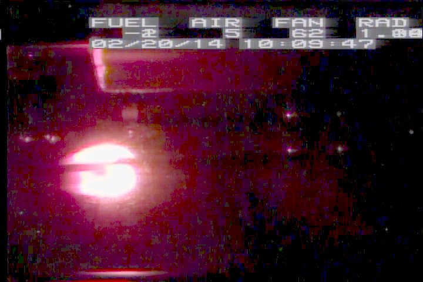
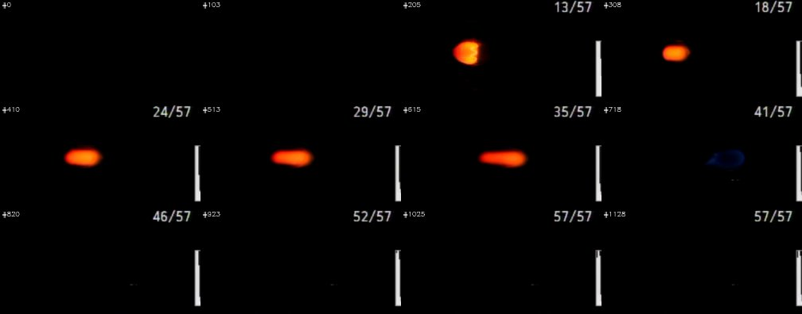

# BASS-II (PSI-25) — calibração espacial do vídeo lateral do B1

Fase P2, 14/11/2026, branch `feat/bass2-propagation`. Resultado formal em `data/bass2/b1/registration.json`, gerado por `scripts/bass2/calibrate_b1.py`.

Marcação: **[NASA]** documento da NASA; **[PSI]** tabela ou listagem do PSI; **[Medição]** feita nesta etapa sobre os arquivos; **[Inferência]**; **[Hipótese]**.

## Veredito

**`status: insufficient`.** Não foi possível estabelecer uma escala confiável em mm/pixel para o vídeo lateral do B1. O `registration.json` não contém transformação, origem, escala, pontos de referência, resíduos nem incerteza, porque nenhum desses valores pode ser obtido sem invenção. A próxima etapa deve medir em pixels e px/s e deixar a conversão em aberto.

## 1. Dimensões físicas documentadas

| Grandeza | Valor | Fonte | Visível no vídeo lateral? |
|---|---|---|---|
| Largura da amostra | 20 mm (2 cm) | CSV e `Test.Matrices.xlsx`, aba Bhattacharjee, célula E2 ("100 micron pmma film, 2 cm wide"); Summary Report, PDF p. 29 e 45 ("20 mm wide"); SRD p. 5 | **Não.** O vídeo vê o filme de perfil, pela janela frontal, ortogonal à câmera de topo (PDF p. 12–13 e 64); a largura fica na linha de visada |
| Comprimento da amostra | "about 95 mm" | PDF p. 29 e 45 | É o eixo de propagação, mas a amostra não aparece nos quadros escuros |
| Espessura | 0,1 mm (100 µm) | E2; SRD p. 5 | Não (sub-pixel, e invisível) |
| Duto | 7,6 × 7,6 × 17 cm; seção de teste de 17 cm | PDF p. 12 e 74 | Paredes pretas, sem iluminação; campo de visão não documentado |
| "Escala móvel" na seção de teste | sem dimensões | PDF p. 12; Ops §5: "the deployed scale may not be visible in the image" | Não identificada |
| Pontos a cada 6 mm | 6 mm | PDF p. 30 e 47 | Não: sobreposição gráfica da análise da SDSU em fotos de topo de outro teste |

**[NASA]** A câmera de vídeo (Panasonic WV-CP654, matriz de 760 × 480 px) olha pela janela frontal através de um espelho (PDF p. 12–13), e "the field of view of the video can not be changed" (SRD p. 1). O campo de visão em milímetros não está em nenhum documento recuperado.

## 2. O que aparece no vídeo lateral **[Medição]**

Fonte: o TS original (`BASS_GMT50_SAMPLE_147_TEST_B1.ts`, 720 × 480).

- Na maior parte do teste o quadro é preto, exceto pela sobreposição e pela chama.
- Nos quadros mais claros da ignição (#327 a #338), o ignitor ilumina brevemente peças do aparato (figura abaixo; máximo dos 12 quadros mais claros com gama 0,35):
  - uma aresta vertical em **x = 158 px**, de y ≈ 90 a 135 px;
  - bordas horizontais e um reflexo na base, em **y ≈ 460–471 px**;
  - uma barra horizontal clara no alto, logo abaixo da sobreposição.
- **Nenhum documento identifica essas peças nem dá suas dimensões.** Elas estão registradas em `pixelObservationsWithoutScale`, com `usableAsReference: false`.

A região iluminada pela chama ao longo do teste (máximo por pixel, `all-frames-max.png` no cache) mostra o caminho da chama no plano da imagem, mas não contém nenhum objeto de tamanho conhecido.

## 3. A sequência de fotografias de topo **[Medição]**

Arquivo `…TEST_B1_Still_Sequence.mp4` (2 831 066 bytes; SHA-256 `ba6fa939…bd8cd66`) e a versão TS do ZIP original.

- **Não contém as fotos em resolução de análise.** É a gravação da tela de revisão da Nikon D300s, mostrando:
  - uma miniatura da foto (~200 × 120 px do quadro de vídeo);
  - o histograma;
  - os metadados: `DSC_7171.NEF` a `DSC_7217.NEF`, foto n/57, RAW 4288 × 2848, ISO 1000, F2, "35mm", compensação −4,0 e hora da câmera 02/19/2014 10:03:42–10:04:33.
- Com exposição de 1/160 a 1/250 s e −4 EV, a miniatura só mostra a chama (mancha laranja) e, na foto 11, a espiral do ignitor. **A amostra, o suporte e as bordas não aparecem.**
- A câmera registrou **57 fotos**, o mesmo valor de `Total Frames Shot` no CSV (célula J2). **[PSI + Medição]**
- **[NASA]** É uma vista de topo, ortogonal à vista lateral do vídeo. Mesmo com a amostra visível, a escala não poderia ser transferida sem um registro geométrico entre as vistas.

**Conclusão:** a sequência de fotografias não permite calibrar o vídeo lateral, nem por transferência nem por si mesma.

## 4. Atalhos avaliados e rejeitados

| Atalho | Por que foi rejeitado |
|---|---|
| Transferir uma escala das fotos de topo | Outra câmera e outro plano de projeção; a amostra nem aparece nas miniaturas |
| Supor que a largura do quadro cobre a seção de teste de 17 cm (≈ 4,2 px/mm, hipótese da P0/P1) | O campo de visão não está documentado; a hipótese continua sem confirmação e não deve ser usada |
| Usar "the flame propagated across half the sample length" (PDF p. 21) | Ponto de partida e comprimento imprecisos ("about 95 mm"), e o mesmo parágrafo dá a velocidade de referência (2,2 mm/s): validar contra ela seria circular |
| Separação entre as duas lâminas da chama | É uma propriedade da chama, não uma dimensão conhecida |
| Peças iluminadas pelo ignitor | Identidade e dimensão desconhecidas |

## 5. Incerteza

Não aplicável: nenhuma escala foi estabelecida.

Para quando houver referências, `calibrate_b1.fit_axis` ajusta `x_mm = s·(x_px − x₀)` por eixo, com resíduos e uma incerteza 1σ da escala. Essa incerteza combina:
- a incerteza das dimensões de referência (`sigma_mm`);
- o erro de localização das bordas (`sigma_px`);
- a dispersão do ajuste, quando houver mais de dois pontos.

Exemplo de ordem de grandeza: 95 mm em 400 px, com 3 px de erro em cada borda, dá ~1% de incerteza relativa. A função `to_mm` recusa qualquer conversão se `registration.status` não for `validated`.

Fatores a incluir quando houver escala:
- **Proporção de pixel:** o MP4 declara 10:11; a do TS não foi determinada. Os eixos x e y precisam de escalas próprias.
- **Distorção e perspectiva:** desconhecidas; o espelho e a lente não estão documentados.
- **Diferença entre original e reencode:** desprezível na imagem (PSNR mediano de 49 dB após o alinhamento; ver o relatório de base temporal), mas o mapeamento de quadros precisa descontar o preenchimento de 30 quadros do MP4.

## 6. Caminhos para destravar

1. **Folha de prova das fotos do B1** (`GMT2014_050_BASS_S147M_TPB1_ProofSheet.pdf`, 264 402 bytes, ainda não baixada). Pode conter a foto pós-queima iluminada com lanterna (Ops §9.12). Daria escala para a vista de topo, não para o vídeo.
2. **Vídeos de outros testes em que o volume de trabalho esteja iluminado ou a escala móvel apareça.** O campo de visão do vídeo é fixo (SRD p. 1). Uma escala medida assim valeria para o B1 se a montagem do suporte for a mesma; isso precisa ser confirmado.
3. **Desenho do suporte de amostra plana e do duto.** Não está entre os documentos do PSI-25.
4. **Medir em pixels agora e converter depois.** Velocidades em px/s e os instantes de regime já podem ser obtidos; a conversão entra quando houver escala.

## 7. Respostas

| Pergunta | Resposta |
|---|---|
| A sequência de fotografias permite calibrar o vídeo lateral? | **Não.** É a tela de revisão da câmera, a amostra não aparece, e a vista é ortogonal à do vídeo |
| Existe escala física confiável em mm/pixel? | **Não** |
| Qual é a incerteza da escala? | Não definida (não há escala) |
