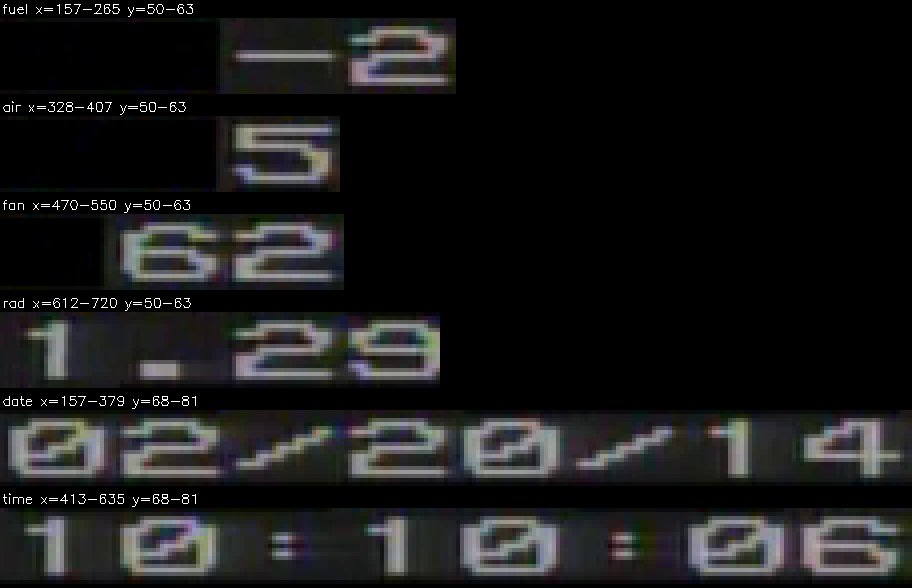
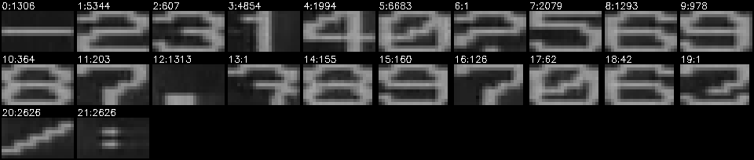
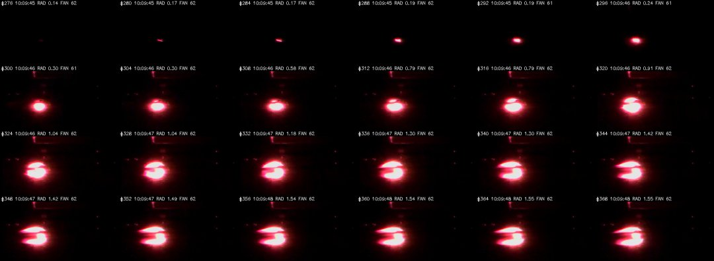
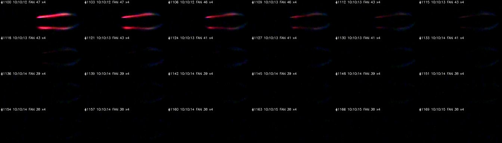

# BASS-II (PSI-25) — teste B1: base temporal, sincronização e telemetria

Fase P2, 14/11/2026, branch `feat/bass2-propagation`. Registro do catálogo `PSI-25:t0:r2` (B1: filme de PMMA de 100 µm, 2 cm de largura, fluxo oposto, 2 restritores, GMT 50 de 2014).

Marcação: **[NASA]** documento da NASA; **[PSI]** tabela ou listagem do PSI; **[Medição]** feita nesta etapa sobre os arquivos; **[Inferência]**; **[Hipótese]**. "PDF p." é a página do arquivo do Summary Report (NASA/TM-20210011385).

**Não há aqui detecção de chama, rastreamento nem velocidade de propagação.** Os eventos visuais (luz, chama, extinção) foram anotados a olho em pranchas de quadros e estão marcados como tal.

## Produtos

| Arquivo | Conteúdo | Git |
|---|---|---|
| `data/bass2/b1/supplements-manifest.json` | Arquivos complementares baixados: nome, endereço estável, tamanho, data, SHA-256 | sim |
| `data/bass2/overlay-glyphs.json` | Geometria da sobreposição, sementes e modelos dos glifos | sim |
| `data/bass2/b1/overlay-manual-annotations.csv` | Leitura a olho de 28 quadros (validação do OCR) | sim |
| `data/bass2/b1/event-annotations.csv` | Eventos com quadro e método (visual ou telemetria) | sim |
| `data/bass2/b1/telemetry.csv` | Telemetria: um registro por estado exibido da sobreposição | sim |
| `data/bass2/b1/timebase.json`, `timebase-frames.csv` | Estrutura temporal, ajuste do relógio, mapeamento MP4 ↔ TS, tempo por quadro | sim |
| `data/bass2/b1/regimes.json` | Regimes de operação e eventos com horário | sim |
| `data/bass2/b1/registration.json` | Calibração espacial (`insufficient`) | sim |
| `data/cache/bass2/b1/…` | ZIP, TS extraídos, leituras por quadro, pranchas | não |

Scripts: `overlay_bass2.py` (leitor da sobreposição), `extract_b1_telemetry.py`, `build_b1_timebase.py`, `calibrate_b1.py`; `fetch_bass2.py` estendido. Ordem de execução:

```powershell
python scripts/bass2/fetch_bass2.py b1 "<nome exato>"          # 2 arquivos, teto de 20 MB
python scripts/bass2/extract_b1_telemetry.py                   # lê TS e MP4 (≈2 min)
python scripts/bass2/build_b1_timebase.py
python scripts/bass2/extract_b1_telemetry.py --reuse           # preenche o tempo experimental e os regimes
python scripts/bass2/calibrate_b1.py
python -m unittest discover -s scripts/bass2 -p "test_*.py"
```

## 1. Recursos complementares recuperados

| Arquivo (PSI-25, pasta Raw Data) | Bytes | SHA-256 |
|---|---:|---|
| `PSI-25_Raw Data_BASS_GMT50_SAMPLE_147_TEST_B1_Still_Sequence.mp4` | 2 831 066 | `ba6fa93947d9271cecc07eddb02852ebbed09306dd7754d9536bf97eabd8cd66` |
| `PSI-25_Raw Data_BASS_GMT50_SAMPLE_147_TEST_B1 original videos.zip` | 14 636 823 | `60174c8d490e4e83d087f2b14f3e19a385737b26cfbed3532118e429cd4eb951` |

- Total: 17 467 889 bytes (teto: 20 MB). Os tamanhos HTTP coincidiram com os do catálogo.
- `fetch_bass2.py` ganhou:
  - o tipo `b1`, com teto próprio e só MP4/ZIP;
  - a exigência de que o nome contenha `SAMPLE_147_TEST_B1`;
  - retomada por `Range` a partir do arquivo `.part`.

Conteúdo do ZIP (listado antes de extrair; o `zipfile` verificou o CRC na extração):

| Membro | Bytes | Data no ZIP | SHA-256 |
|---|---:|---|---|
| `BASS_GMT50_SAMPLE_147_TEST_B1.ts` | 9 661 132 | 2014-02-19 10:18:26 | `8ab341de…33fbd8d` |
| `BASS_GMT50_SAMPLE_147_TEST_B1_Still_Sequence.ts` | 8 085 128 | 2014-02-19 10:42:48 | `c19628a9…182ec67` |

Não há imagens de calibração, quadros avulsos nem metadados adicionais no ZIP.

## 2. Original × reencode **[Medição]**

| | TS original | MP4 do PSI |
|---|---|---|
| Contêiner | MPEG-TS; PID 42 H.264 (tipo 0x1B), PID 45 AAC (0x0F) | MP4 (`avc1` + `mp4a`) |
| Resolução | 720 × 480 | 720 × 480; `pasp` 10:11 |
| Quadros | 1 317 PES de vídeo; **1 313 decodificáveis** | 1 343 |
| Tempo | PTS reais; passos de 33/34 ms, um de 67 ms no início | 1001/30000 s constante |
| Duração | 43,94 s (PES); 43,78 s decodificáveis | 44,81 s |
| Taxa de bits | ~1,76 Mbit/s (vídeo + áudio) | ~1,04 Mbit/s |

- **Quadros perdidos no TS:** os 4 primeiros PES não decodificam, porque o fluxo começa no meio de um GOP e referenciam um PPS ainda não recebido. Cada um dos 1 313 quadros decodificados corresponde a um PTS do fluxo, com erro zero.
- **Preenchimento no MP4:** os 30 primeiros quadros do MP4 (1,001 s) são cópias do primeiro quadro decodificável do TS (diferença interna ≈ 1×10⁻⁴ níveis de cinza). A partir daí, **MP4[i] = TS[i − 30]** até o fim, sem repetições nem saltos.
  - Deslocamento ótimo de 30 quadros: diferença média de 0,064 níveis de cinza, contra 0,110 com 31.
  - A sobreposição coincide em 1 312 de 1 313 pares.
  - O preenchimento cobre o áudio, que começa 0,845 s antes do primeiro PES de vídeo e 1,012 s antes do primeiro quadro decodificável **[Medição]**. Que essa seja a causa é **[Inferência]**.
- **Qualidade de imagem:** PSNR mediano de 49,4 dB entre os pares alinhados (mínimo 47,2 dB; 48,8 dB nos quadros com chama); a nitidez da sobreposição é a mesma (variância do laplaciano 1 124 × 1 121). **O reencode não removeu informação útil da imagem.**
- **Sequência de fotos:** o mesmo padrão. O TS decodifica 1 089 quadros, e o MP4 tem 1 129.
- **Correção da P0/P1:** a "deriva de ~4%" do MP4 relatada antes não existe. Ver §6.

**Recomendação:** usar o TS como fonte primária (PTS reais) e, se o MP4 for usado, aplicar o deslocamento de 30 quadros.

## 3. Dimensões físicas e geometria do B1

Ver `BASS2_B1_SPATIAL_CALIBRATION.md` §1–3. Resumo **[NASA/PSI]**:
- Filme de PMMA de 100 µm, 20 mm de largura e cerca de 95 mm de comprimento, queimado em fluxo oposto.
- Ignição na ponta esquerda e fluxo da direita para a esquerda (PDF p. 29).
- O vídeo vê o filme de perfil.
- A largura de 20 mm é a única dimensão citada em todos os documentos, mas fica na linha de visada da câmera lateral.

## 4. Calibração espacial

**`status: insufficient`** (`data/bass2/b1/registration.json`):
- Nenhuma dimensão documentada aparece no plano do vídeo lateral.
- As peças iluminadas pelo ignitor (aresta em x = 158 px, bordas em y ≈ 460–471 px) não têm identidade nem dimensão documentadas.
- A sequência de fotos é a tela de revisão da câmera, sem a amostra, e é ortogonal ao vídeo.

## 5. Incerteza da calibração

Não definida, porque não há escala. O procedimento e as funções para quando houver referências estão em `BASS2_B1_SPATIAL_CALIBRATION.md` §5.

## 6. Base temporal **[Medição]**

### 6.1 Estrutura

- TS: 1 313 quadros decodificáveis; passos de PTS de 33 ms (835) e 34 ms (480), mais um de 67 ms antes do primeiro quadro decodificável. Não há lacunas entre os quadros decodificados.
- MP4: 1 343 quadros, os 30 primeiros de preenchimento (§2).
- Não há quadros duplicados no TS. No MP4, só os 30 iniciais.

### 6.2 O relógio da sobreposição

| Campo | Posição (px, TS 720 × 480) | Formato |
|---|---|---|
| Data | x 157–379, y 68–81 | `MM/DD/AA`, sempre `02/20/14` nos 1 313 quadros |
| Hora | x 413–635, y 68–81 | `HH:MM:SS`, de `10:09:36` a `10:10:19` |

- A fonte é de largura fixa: passo de 28,43 px, glifo de 23 × 13 px.
- **Data exibida × data real:** 02/20/14 no vídeo; 2014-02-19 no CSV e na câmera fotográfica. É o dia a mais documentado no ReadMe ("Video display is one day later than actual date due to a leap year"). Os dois valores ficam preservados (`date_display_raw` e a data do catálogo).
- O relógio só avança em passos de 1 s: 43 viradas e nenhuma descontinuidade. Cada segundo fica na tela por 25, 31 ou 32 quadros (média de 30,0).
- **Atualização da sobreposição:** intervalos mais frequentes de 6 ou 7 quadros. O ajuste dá período de 0,203 s (**4,9 Hz**), com variação de ~2 quadros. Os documentos dizem 4 Hz (SRD p. 1) ou 5 Hz (ReadMe). Um mesmo valor fica vários quadros na tela: **os quadros não são observações independentes**.



## 7. Sincronização com o relógio experimental

Definições (`timebase.json`, `definitions`):
- `timestamp_video_s` = PTS do quadro no TS menos o PTS do primeiro quadro decodificável.
- `timestamp_experiment_s` = relógio da sobreposição em segundos do dia.
- "Virada" = primeiro quadro que exibe um novo segundo.

Ajuste por mínimos quadrados sobre as 43 viradas: **t_relógio = a + b·(t_vídeo − 0,167 s)**.

| Grandeza | TS | MP4 |
|---|---|---|
| Intercepto | 10:09:36,143 ± 0,020 s | 10:09:35,143 (1,001 s antes: o preenchimento) |
| Inclinação b | 0,99955 ± 0,00078 | 0,99950 ± 0,00078 |
| Deriva | −0,045% ± 0,08% (compatível com zero) | idem |
| Resíduo RMS / máximo | 0,062 s / 0,114 s | 0,062 s / 0,114 s |

Leitura:
- **Uma reta é adequada.** Não há deriva detectável nem descontinuidade.
- Os resíduos (5º a 95º percentil: −0,09 a +0,09 s) são do tamanho da quantização imposta pela atualização da sobreposição.
- A interpolação linear entre viradas consecutivas difere da reta em no máximo 0,114 s.
- `timebase-frames.csv` traz as duas versões por quadro, além do relógio exibido.

**Viés conhecido, não corrigido:** cada virada aparece depois da virada real do segundo, no máximo uma atualização mais um quadro (0 a 0,236 s). A reta pelas viradas fica, portanto, **adiantada**: o relógio verdadeiro ≈ `timestamp_experiment_fit_s` + 0 a 0,24 s (~0,12 s em média). Isso foi verificado com relógio sintético nos testes. Para intervalos entre eventos o viés se cancela; para tempos absolutos, a incerteza é de ~±0,12 s.

**Relógio da câmera fotográfica × relógio do vídeo [Medição + Hipótese]:**
- A foto 10 (câmera 10:03:42) está escura e a foto 11 (10:03:43) mostra o ignitor aceso.
- No vídeo, a primeira luz aparece às 10:09:45,4.
- A câmera fica ~6 min 2–3 s atrás do relógio do vídeo, além da diferença de um dia.
- O Apêndice A registra, para GMT 45, que o vídeo estava "1 day plus 6 min 10 s ahead of actual GMT" (PDF p. 120). Se a câmera marca o GMT real, a defasagem de GMT 50 seria parecida. Não há documento que confirme isso para GMT 50.

## 8. Extração da telemetria

### 8.1 Método

- **OCR disponível:** nenhum. Não há `tesseract`, `pytesseract`, `easyocr` nem o módulo `cv2.text`. Nada foi instalado.
- **Leitura por modelos de glifo** (`overlay_bass2.py`):
  - Cada célula da fonte de largura fixa é comparada com 19 modelos por correlação normalizada (`cv2.matchTemplate`), com tolerância de ±3 px.
  - Os modelos são médias de até 40 ocorrências reais no TS. Os rótulos foram dados por inspeção visual dos grupos de células e conferidos pela sequência do relógio. Os grupos estão em `overlay-glyphs.json`, com o vídeo de origem (SHA-256), os quadros e as células.
  - Três grupos de um único membro (dois dígitos misturados em quadros de transição) não viraram modelo.
- **Recusa em vez de palpite:**
  - célula com correlação < 0,80 ou margem para o segundo rótulo < 0,04 → `?`;
  - campo que não casa com o padrão (`d.dd` no RAD, `HH:MM:SS` na hora…) → `unreadable`;
  - confiança `high` exige correlação ≥ 0,90 e margem ≥ 0,08.



### 8.2 Resultado

- **1 313 quadros lidos.** 1 310 têm todos os campos com confiança alta. Os 3 restantes têm um caractere misturado e ficaram com `?`: quadro 342 (RAD `1.?0`), 1055 (RAD `1.2?`) e 1248 (FUEL `-?`).
- **Validação independente:** 28 quadros lidos a olho (`overlay-manual-annotations.csv`; 24 espaçados uniformemente, os 3 ambíguos e 3 do corte do ventilador) → **168 de 168 campos coincidem**. Nos três quadros de transição o olho também não decide, e a anotação manual é `?`, como o OCR.
- **MP4:** com a mesma geometria, a leitura coincide com a do TS em 1 312 de 1 313 quadros pareados.
- `telemetry.csv` tem **284 estados exibidos** (sequências de quadros com texto idêntico; mediana de 4,5 quadros por estado). Cada estado traz:
  - `source_frame`, `last_frame`, `frames`;
  - `timestamp_video_s`;
  - `clock_display_raw` e `timestamp_experiment_s` / `_clock` (da reta);
  - os quatro valores brutos;
  - `ocr_confidence`, `ocr_min_score`, `ocr_min_margin` e `source = ocr-template:ts`.

Valores encontrados (quadros em que cada valor aparece):

| Campo | Valores | Unidade e tratamento |
|---|---|---|
| FUEL | −2 (1 084), −1 (148), −3 (61), −4 (12), 0 (7), `-?` (1) | Vazão de N₂ em cm³/min **[NASA, p. 13]**. N₂ desligado no teste: ruído em torno de zero **[Inferência]**. `n2_flow_cm3_min` repete o valor exibido |
| AIR | 5 (1 211), 4 (95), 6 (7) | Transdutor em cm/s, resposta de ~1 min **[NASA]**. `air_transducer_cm_s` é a leitura, **não a velocidade instantânea na chama** |
| FAN | 62 (933), 61 (116), 38 (157), 37 (7) e 59…39 durante a rampa | Tensão × 10 **[NASA, ReadMe]**: `fan_voltage_v = FAN/10` (conversão documentada). A velocidade **não** é coluna da telemetria (§9) |
| RAD | 0,05 a 1,55 | Sinal não calibrado **[NASA]**; ganho 50 (CSV, célula I2). Sem conversão física |

## 9. Regimes do B1

Os limites vêm de `event-annotations.csv`; a telemetria e os horários vêm de `regimes.json`. Horários pela reta (§7), relógio do vídeo, data exibida 02/20/14.

| Regime | Quadros TS | Início | Fim | FAN | AIR | FUEL | RAD |
|---|---|---|---|---|---|---|---|
| Antes da ignição | 0–279 | 10:09:36,14 | 10:09:45,45 | 61–62 | 5 (4 em 3 instantes) | −3 a −1 | 0,05 → 0,14 |
| Ignição (ignitor e chama sobrepostos) | 280–331 | 10:09:45,48 | 10:09:47,18 | 61–62 | 5 | −2 a −1 | 0,17 → 1,18 |
| Chama estabelecida, FAN constante | 332–1048 | 10:09:47,22 | 10:10:11,09 | 61–62 | 5 (4 e 6 em instantes) | −4 a 0 | 0,86–1,55 (máx. 1,55 às 10:09:48,2) |
| Redução de FAN | 1049–1148 | 10:10:11,13 | 10:10:14,43 | 59 → 39 | 5 | −2 a −1 | 1,27 → 0,75 |
| FAN no mínimo | 1149–1312 | 10:10:14,46 | 10:10:19,90 | 38 (37) | 5 → 4 às 10:10:17,80 | −4 a −1 | 0,75 → 0,22 |

Eventos:

| Evento | Quadro | Horário (reta) | Método |
|---|---|---|---|
| Primeira luz visível | 276–280 | 10:09:45,35–45,48 | Visual (`ignition-sequence.jpg`) |
| Ignitor e chama indistinguíveis | 280–331 | — | Visual |
| Duas lâminas de chama evidentes | 324–332 | 10:09:46,95–47,22 | Visual |
| Início da queda de FAN (59) | 1049 | 10:10:11,13 | Telemetria |
| FAN ≤ 55 / ≤ 47 / ≤ 42 | 1067 / 1099 / 1124 | 10:10:11,73 / 12,79 / 13,63 | Telemetria |
| Última chama vermelha nítida | 1109 | 10:10:13,13 | Visual |
| Última chama azul fraca (ganho ×4) | 1133 (dúvida até 1142) | 10:10:13,93 (até 14,23) | Visual (`extinction-gain4.jpg`) |
| FAN = 38 | 1149 | 10:10:14,46 | Telemetria |
| AIR passa de 5 para 4 | 1249 | 10:10:17,80 | Telemetria |





### Distinção entre FAN, ar real e AIR

- **Mudança de FAN:** visível no instante em que o tripulante gira o potenciômetro. Em B1 é uma **rampa de 3,3 s** (59 → 39, de 10:10:11,1 a 10:10:14,4), não um degrau.
- **Velocidade real do ar na chama:** não medida diretamente. Ela segue a FAN com um atraso de transporte que não está documentado (PDF p. 21: "there is a time lag between when the velocity is reduced and when the reduced velocity reaches the flame").
- **AIR:** só cai de 5 para 4 às 10:10:17,8, **6,7 s depois do início da rampa** e 3,3 s depois de FAN chegar ao mínimo. Até o fim do vídeo não passa de 4, por causa da resposta de ~1 min. **Durante e depois do corte, AIR não representa o fluxo.**

### Velocidade do ar nos regimes de FAN constante

| Fonte | Valor | Base |
|---|---|---|
| Calibração do mesmo dia e restritor | **6,45–6,69 cm/s** para FAN 61–62 | Planilha `Fan calibration data.xlsx`, colunas O:Q, dia "2014-50- post soot cleaning", bloco de 2 restritores (células Q26–Q32). Interpolação entre FAN 55 → 5 cm/s (Q30) e FAN 72 → 9 cm/s (Q29), × 1,0066 (A33/E7). A ordem dos blocos da planilha é **[Inferência]** |
| Transdutor durante o teste | **5,03 cm/s** (AIR = 5 × 1,0066) | Leitura estável durante 35 s com FAN constante. Não é possível verificar se o transdutor já estava acomodado (~1 min), porque o vídeo começa 11 s antes da ignição |

As duas fontes divergem em ~1,5 cm/s (~25%). Possíveis causas, nenhuma confirmada **[Hipótese]**:
- a calibração foi feita no fim do dia, depois de uma limpeza de fuligem;
- a resolução do mostrador (±0,5 cm/s);
- a exatidão de ±10% do hardware (SRD).

Para os regimes de rampa e de FAN mínimo **não há velocidade**: FAN está variando ou abaixo de 42, onde a planilha desaconselha o uso, e AIR está atrasado.

**[NASA]** O próprio relatório avisa que "the calibration at such low velocity has high error bars" (PDF p. 21).

## 10. Comparação com a documentação NASA

| Fonte | O que diz | O que o vídeo mostra | Avaliação |
|---|---|---|---|
| CSV / Test.Matrices (Bhattacharjee, linha 2) | Fan 62, Air 5, restritor 2, ganho 50, 57 fotos | FAN 61–62, AIR 5 (o restritor não aparece no vídeo); 57 fotos na tela da câmera | Coerente |
| ReadMe | Data no vídeo um dia depois | 02/20/14 no vídeo; 02/19/2014 na câmera | Confirmado |
| ReadMe / SRD | Sobreposição a 5 Hz / 4 Hz | 4,9 Hz, com variação de ~2 quadros | Mais perto de 5 Hz |
| Apêndice A, B1 (PDF p. 111) | As-run 7; "10:09:50 to 10:10:16" (horário do vídeo) | Luz às 10:09:45,4; chama estabelecida às 10:09:47,2; extinção às ~10:10:14 | O apêndice dá horários "aproximados"; o início observado é 4,6 s antes e a extinção 2 s antes do fim anotado |
| Apêndice A, observação do B1 | "Ignited very quickly, turned flow off after spread halfway; flame extinguished very quickly; and sooty with blue leading edge" | ~1,7 s entre a primeira luz e a chama estabelecida; chama vermelha com ponta azulada; extinção durante a rampa de FAN | Coerente |
| PDF p. 21 | "the flow was abruptly cut off and the flame was observed to extinguish within 2 s" | A rampa de FAN durou 3,3 s. A chama some 2,8–3,1 s depois do início da rampa, mas 1,1–1,4 s depois de FAN ≤ 47 (≈ 2,5 cm/s pela calibração) e antes de FAN chegar a 38 | Compatível se o corte for contado a partir de quando o fluxo ficou baixo; "abruptly" não descreve a rampa observada |
| PDF p. 21 | 2,2 mm/s de propagação estável | Não verificável nesta etapa (sem escala e sem rastreamento) | Pendente |

## 11. Testes

`python -m unittest discover -s scripts/bass2 -p "test_*.py"` → **59 testes, todos passando** (26 da P0/P1 + 33 novos).

| Arquivo | Testes | O que cobre |
|---|---:|---|
| `test_b1_calibration.py` | 7 | Transformação px → mm, origem e resíduo zero com pontos exatos; resíduo com referências inconsistentes; incerteza que cresce com o erro de localização; recusa de um ponto ou de pontos degenerados; recusa de conversão sem calibração validada; `registration.json` real sem escala inventada; dimensões com fonte |
| `test_b1_telemetry.py` | 26 | Leitura de todos os campos em quadros sintéticos; ruído e deslocamento de 2 px; FAN de 3 dígitos e todos os dígitos; campo ausente ≠ zero; glifo misturado recusado; padrão de campo; parsing de números e relógio (inválidos e fora de faixa); agrupamento de leituras repetidas; colunas brutas separadas das derivadas; valor ilegível em branco; tempo experimental só com base válida; `?` manual × leitura; calibração do FAN (interpolação, fora de faixa, nunca de outro dia ou restritor); viradas do relógio; ajuste com deriva e viés de quantização; descontinuidade excluída; poucas viradas; interpolação; deslocamento constante com preenchimento; PTS de um TS sintético; produtos reais do B1 (ajuste, MP4 = TS + 30, telemetria, 168/168 anotações, regimes que separam AIR atrasado e calibração) |

Os testes com dados reais são pulados se o cache ou os produtos não existirem. Não foi criado teste para as mudanças do `fetch_bass2.py` (tipo `b1`, retomada por `Range`): elas exigiriam simular o servidor e foram verificadas só pelo download real.

## 12. Limitações

- **Escala espacial ausente:** bloqueia qualquer grandeza em mm.
- **Eventos visuais anotados a olho** em pranchas de 3 ou 4 quadros: precisão de ±2–4 quadros (±0,1 s), além do viés do relógio.
- **Ignição:** brilho do ignitor e chama não se separam nos quadros 280–331; o desligamento do ignitor não é visível.
- **Modelos de glifo:** medidos e validados só no B1. Outros vídeos BASS-II precisam ter a geometria conferida antes do reuso (`layout.measuredOn`).
- **Velocidade do ar:** a calibração do dia e a leitura do transdutor divergem ~25%; e a velocidade durante a rampa é desconhecida.
- **O₂:** não aparece na sobreposição, e o valor do CSV para GMT 50 é incerto segundo o próprio relatório (revisão documental §7.3).
- **Relação câmera fotográfica ↔ GMT real:** não documentada para GMT 50.

## 13. Prontidão para a próxima etapa

**Pronto:**
- Fonte primária definida: TS original, com PTS reais. O índice MP4 = TS + 30.
- Tempo experimental por quadro (`timebase-frames.csv`), incerteza absoluta de ~±0,12 s e relativa desprezível.
- FAN, AIR, FUEL e RAD por quadro e por estado, com confiança e validação.
- Intervalo de **chama estabelecida com FAN constante: quadros 332–1048 (≈ 23,9 s)**. É a janela natural para estimar a velocidade de propagação, a ser comparada com os 2,2 mm/s publicados.
- Janelas a excluir ou tratar à parte: ignição (280–331) e rampa (1049–1148).
- Máscara da sobreposição: y < 85 px e a faixa x ≈ 150–720.

**Bloqueado:**
- Conversão para mm (`registration.json`: `insufficient`). A segmentação e o rastreamento podem prosseguir **em pixels**.
- A velocidade da frente pode ser obtida em px/s.

**Respostas aos critérios de conclusão:**

| # | Pergunta | Resposta |
|---|---|---|
| 1 | A sequência de fotografias calibra o vídeo lateral? | Não |
| 2 | Há escala física confiável em mm/pixel? | Não |
| 3 | Incerteza da escala? | Não definida (sem escala) |
| 4 | Relação MP4 ↔ relógio? | t_relógio = 10:09:36,143 + 0,99955·(t_TS − 0,167 s), sem deriva, resíduo ≤ 0,114 s; MP4 = TS deslocado de 30 quadros (1,001 s) |
| 5 | Instante de ignição? | Primeira luz às 10:09:45,4 (quadro 276–280); chama estabelecida às 10:09:47,2 (quadro ~332). O instante exato da ignição da amostra não se separa do brilho do ignitor |
| 6 | Mudança de FAN? | Sim: rampa de 10:10:11,13 (quadro 1049) a 10:10:14,46 (quadro 1149) |
| 7 | Extinção? | Sim, visualmente: última chama azul fraca às 10:10:13,9–14,2 (quadros 1133–1142) |
| 8 | FUEL, AIR, FAN e RAD extraídos? | Sim, nos 1 313 quadros; 3 caracteres recusados; 168/168 contra anotação manual |
| 9 | Calibração para converter FAN? | Existe (GMT 50, 2 restritores, colunas O:Q) e dá 6,45–6,69 cm/s, mas diverge da leitura do transdutor durante o teste (5 cm/s). Nenhuma das duas está confirmada como a velocidade na chama |
| 10 | Como reconstruir os regimes? | FAN e relógio por quadro para os limites; eventos visuais anotados; velocidade só nos regimes de FAN constante, pelas duas fontes, com a divergência explícita (§9) |
