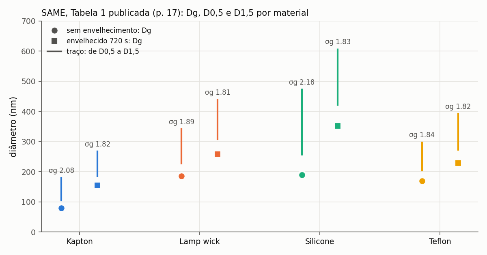
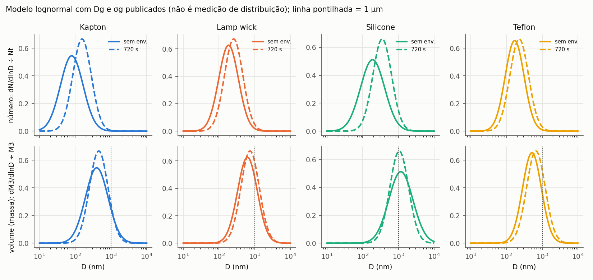
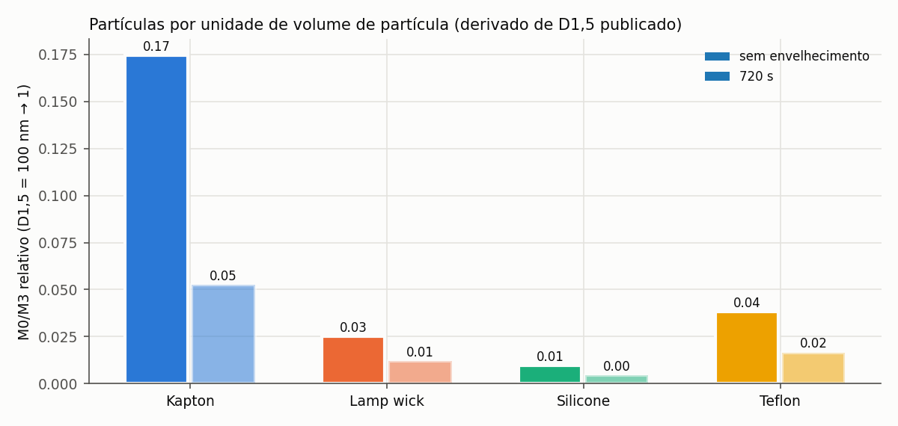
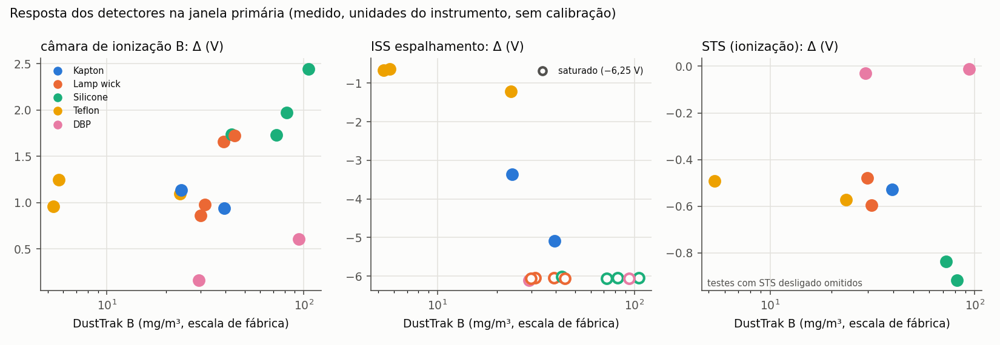
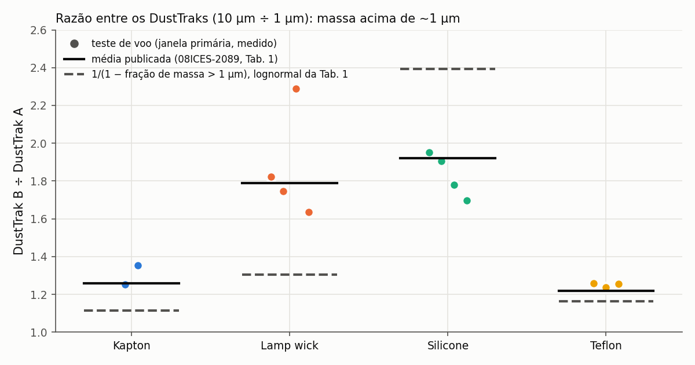

# SAME (PSI-102): primeira análise científica

**Entradas:**

- [`data/same/derived/same-tests.json`](../../data/same/derived/same-tests.json): 47 testes do Apêndice A, 15 com janelas de amostragem medidas.
- Tabela 1 e apêndices do Final Science Report (NIST/NASA, 2010).

**Saída:** [`data/same/derived/same-analysis.json`](../../data/same/derived/same-analysis.json). Cada número traz um campo `kind`: `published`, `derived`, `measured` ou `model`.

**Figuras:** [`docs/research/img/same/`](img/same/).

Rótulos: **[NASA]**, **[Medição]**, **[Derivado]**, **[Modelo]** (consequência da hipótese lognormal aplicada a parâmetros publicados), **[Inferência]**, **[Hipótese]**.

**O SAME estuda fumaça de pirólise abaixo da ignição.** Nada aqui é velocidade de chama, nem deve ser convertido nisso.

## 1. Resumo

1. **Tabela 1 reproduzida (aritmética).** Os Dg e σg publicados decorrem dos D0.5 e D1.5 publicados pelas Eqs. 7–8, com |ΔDg| ≤ 0,8 nm e |Δσg| ≤ 0,005. **Os D0.5 e D1.5 não podem ser reproduzidos a partir dos dados PSI-102:** faltam as calibrações e as diluições ([SAME_MOMENT_METHOD.md](SAME_MOMENT_METHOD.md) §5).
2. **Razão DustTrak B/A reproduzida a partir dos dados brutos de voo.** É a única grandeza publicada que não depende de calibração absoluta. As médias por material ficam a menos de 5 % dos valores publicados em 2008 (§5).
3. **Envelhecimento.** **[Medição]** O sinal de massa (DustTrak B) se conserva em 0,84–1,20 após 720–1 800 s de envelhecimento, e a fração de massa acima de 1 µm cresce levemente. **[NASA]** Todos os diâmetros crescem, e σg cai de 1,84–2,18 para 1,81–1,83. Os dois fatos juntos são coerentes com coagulação e poucas perdas nas paredes.
4. **Materiais.** Kapton e Teflon produzem fumaça fina, com pouca massa acima de 1 µm (B/A ≈ 1,25–1,30). Silicone e lamp wick produzem fumaça larga, com cerca de 45 % da massa acima de 1 µm segundo a razão dos DustTraks.
5. **Detectores.** O espalhamento ISS satura com silicone, lamp wick e DBP, mas responde pouco ao Teflon (Δ ≈ −0,6 a −1,2 V). O STS (ionização) responde a todos os materiais em que estava ligado.
6. **Bloqueios.** M0, M1 e M3 por teste dependem de coeficientes que não estão no PSI. O P-Trak opera sob diluição em malha fechada. O STS estava desligado nos testes de envelhecimento longo.

## 2. Tabela 1 do relatório: reprodução

**[NASA]** Tabela 1, p. 17. As linhas são "baseline runs (no aging)" e "720 second aging runs" (p. 15). **[Derivado]** Os valores recalculados vêm de D0.5 e D1.5 pelas Eqs. 7–8.

| Material | Estado | Dg pub. (nm) | D0.5 (nm) | D1.5 (nm) | σg pub. | Dg recalc. | σg recalc. |
|---|---|---:|---:|---:|---:|---:|---:|
| Kapton | sem env. | 80 | 105 | 179 | 2,08 | 80,4 | 2,076 |
| Kapton | 720 s | 155 | 186 | 267 | 1,82 | 155,2 | 1,824 |
| Lamp wick | sem env. | 186 | 227 | 341 | 1,89 | 185,2 | 1,893 |
| Lamp wick | 720 s | 258 | 308 | 438 | 1,81 | 258,3 | 1,810 |
| Silicone | sem env. | 189 | 257 | 472 | 2,18 | 189,6 | 2,181 |
| Silicone | 720 s | 352 | 422 | 606 | 1,83 | 352,2 | 1,825 |
| Teflon | sem env. | 170 | 205 | 297 | 1,84 | 170,3 | 1,838 |
| Teflon | 720 s | 228 | 273 | 392 | 1,82 | 227,8 | 1,825 |

**O que a reprodução prova e o que não prova.** Ela prova que a Tabela 1 é internamente consistente com o método publicado. Ela não prova que os D0.5 e D1.5 estão corretos: esses números dependem das calibrações NIST (P-Trak por tamanho, câmara de ionização vs EAD, DustTrak vs TEOM por fonte), das diluições e das densidades. Nada disso foi publicado no PSI.

A Tabela 1 é **agregada por material**: não se sabe quais testes entraram em cada linha.

## 3. Respostas às perguntas da fase

### 3.1 Como o material influencia a distribuição de partículas?

**[NASA]** Kapton tem o menor Dg (80 nm) e o σg mais largo entre os finos (2,08). Silicone tem o D1.5 maior (472 nm) e o σg maior (2,18).

**[Modelo]** Pela lognormal com os parâmetros publicados, a mediana de massa (MMD) é:

| Material | MMD (nm) |
|---|---:|
| Kapton | 398 |
| Teflon | 518 |
| Lamp wick | 628 |
| Silicone | 1 175 |

A fração de massa acima de 1 µm é de 10 % (Kapton), 14 % (Teflon), 23 % (lamp wick) e 58 % (silicone).

**[Medição]** O Rt/R0 do fio difere por material:

| Material | Rt/R0 |
|---|---:|
| Teflon | 1,44 |
| Kapton | 1,38 |
| Silicone | 1,32–1,38 |
| Lamp wick | 1,24 (1,32 no teste 46) |
| DBP | 1,18 |

A vazão do LFE durante o aquecimento também difere: 40 sccm (Teflon), cerca de 30 sccm (Kapton e lamp wick), 25–30 sccm (silicone) e 100 sccm (DBP).

**[Inferência]** Material e condição de aquecimento estão confundidos no desenho experimental: cada material foi aquecido no seu próprio set-point. As diferenças entre materiais não podem ser atribuídas só à química.

### 3.2 Como o tempo de envelhecimento modifica o tamanho?

**[NASA]** Com 720 s de envelhecimento:

| Material | Dg | D1.5 |
|---|---|---|
| Kapton | ×1,94 | ×1,49 |
| Silicone | ×1,86 | ×1,28 |
| Lamp wick | ×1,39 | ×1,28 |
| Teflon | ×1,34 | ×1,32 |

**[Derivado]** σg diminui em todos os casos (−0,02 a −0,35). A distribuição estreita, como prevê a coagulação.

**[Medição]** Nos testes de envelhecimento longo (23, 26, 29, 32, 35 e 46), a razão B/A sobe de 1,825 para 1,907 (silicone) e de 1,69 para 1,75 (lamp wick), e fica estável no Kapton (1,25) e no Teflon (1,24). Há, portanto, mais massa acima de cerca de 1 µm depois do envelhecimento nas fumaças largas.

*As curvas são o modelo lognormal com parâmetros publicados, não uma distribuição medida.*

### 3.3 Como o fluxo de ar influencia o transporte?

**[NASA]** O sistema foi projetado para 2 a 8 cm/s sobre a amostra. O Apêndice A registra "using 2 cm/s" (testes 33 e 34) e "8 cm/s" (teste 37), com alinhamento dos comentários não garantido.

**[Medição]** O LFE é constante dentro de cada material (desvio-padrão < 0,1 sccm, exceto silicone: 25–30 sccm).

**[Inferência]** Não há variação de fluxo dentro de um mesmo material nos testes processados com qualidade suficiente para isolar o efeito do fluxo. **O efeito do fluxo de ar não pode ser estimado com estes dados.**

**[NASA]** O relatório conclui, por modelo FDS do laboratório Destiny, que a mistura domina o transporte e que os atrasos de detecção em microgravidade são maiores (Resumo; Apêndice E).

### 3.4 Qual a diferença entre distribuição numérica e de massa?

**[Modelo]** Com σg ≈ 1,8–2,2, a mediana de massa fica de 2,9 a 6,2 vezes acima da mediana numérica. No silicone sem envelhecimento, só 1,7 % das partículas (em número) passam de 1 µm, mas elas carregam 58 % da massa.

**[Derivado]** Para o mesmo volume total de partículas, o Kapton tem (472/179)³ ≈ 18 vezes mais partículas que o silicone.

### 3.5 Como o envelhecimento afeta o número de partículas?

**[Derivado]** Se o volume de partículas (M3) se conserva, M0 escala com D1.5⁻³. A queda prevista do número após 720 s é:

| Material | Número final / inicial |
|---|---:|
| Kapton | 0,30 |
| Teflon | 0,44 |
| Lamp wick | 0,47 |
| Silicone | 0,47 |

**[Medição]** A hipótese de conservação de M3 é sustentada pelo DustTrak B:

| Teste | Material | DustTrak B secundário/primário |
|---|---|---:|
| 26 | Teflon | 1,05 |
| 29 | Kapton | 1,20 |
| 32 | Lamp wick | 0,99 |
| 46 | Lamp wick (≈ 30 min) | 0,97 |
| 23 | Silicone | 0,84 |
| 35 | Silicone | 0,92 |

**[NASA]** A Fig. 13 e o texto da p. 15 descrevem queda forte do P-Trak com massa estável.

**Por que o P-Trak não serve aqui.** A queda do número **não pode ser medida diretamente nos dados PSI**: o diluidor dinâmico regula a contagem do P-Trak. Vários testes leem cerca de 22 850 pt/cc na janela secundária, o que é sinal do controle, e não da concentração.

**Janelas secundárias curtas.** Nas janelas secundárias com intervalo de 14 a 140 s, o DustTrak B cai a 0,08–0,50 do primário. **[Hipótese]** Isso refletiria a fração de volume residual da câmara, e não um processo do aerossol. Essas janelas não entram nas conclusões.

### 3.6 Quais partículas são mais difíceis de detectar opticamente?

**[NASA]** O detector da ISS tem sensibilidade mínima de 0,3 µm e é pouco sensível abaixo do comprimento de onda do laser IR.

**[Modelo]** A fração de partículas acima de 300 nm, sem envelhecimento:

| Material | Fração > 300 nm |
|---|---:|
| Kapton | 3,6 % |
| Teflon | 17,6 % |
| Lamp wick | 22,5 % |
| Silicone | 27,8 % |

**[Medição]** O espalhamento ISS na janela primária fica entre −0,6 e −1,2 V para Teflon, entre −3,4 e −5,1 V para Kapton, e satura (−6,25 V) para silicone, lamp wick e DBP.

**[Inferência]** Fumaças finas (Kapton e Teflon) são as mais difíceis para detectores de espalhamento. O Teflon é o pior caso, apesar de concentrações de massa comparáveis (DustTrak B de 5,3 a 23,5 mg/m³).

### 3.7 Ionização vs espalhamento

**[Medição]** A câmara de ionização B responde a todos os materiais sólidos (Δ = +0,86 a +2,44 V) e é mais ordenada pela concentração do que pelo tamanho. O STS (ionização), quando ligado, deflete de −0,48 a −0,92 V em todos os sólidos.

**[NASA]** "All of the tests ... show strong signals on the Space Shuttle detector (ionization)" (p. 18).

**[Inferência]** Os dois princípios são complementares:

- a ionização pesa o número e o diâmetro (≈ M1) e capta fumaça fina;
- o espalhamento pesa a massa ou o volume de partículas grandes e satura com fumaça grossa.

**[NASA]** É a recomendação do relatório (p. 19): um detector que meça mais de um momento ou classifique tamanhos.

*Valores em volts, sem calibração. Círculos vazados indicam ISS saturado. Os testes com STS desligado foram omitidos.*

### 3.8 Quais condições estão documentadas o bastante para comparar?

**[Medição]** Dentro de cada material sólido, os testes processados compartilham Rt/R0 e vazão LFE. São comparáveis entre si, em instrumento e janela iguais:

| Material | Testes |
|---|---|
| Kapton | 29, 33 |
| Lamp wick | 17, 32, 34, 46 |
| Silicone | 23, 24, 27, 35 |
| Teflon | 25, 26, 28 |

A comparação **entre** materiais tem o confundimento de §3.1.

A taxa de perda de massa por teste (mg/min) **não existe** nos arquivos. A tabela PSI dá apenas a matriz planejada.

### 3.9 É possível reproduzir a Tabela 1?

- **Aritmética:** sim (§2).
- **A partir dos dados de voo:** não. Os D0.5 e D1.5 exigem calibrações e diluições não publicadas.
- **Única grandeza reproduzível de ponta a ponta:** a razão DustTrak B/A da Tabela 1 de 2008 (§5).

### 3.10 O que pode alimentar um modelo futuro de fumaça?

Ver §6.

## 4. Condições por teste

**[Medição]** Testes processados por janela de solenoide:

- "Env. sec." indica envelhecimento secundário: "long" significa intervalo de 570–1 653 s entre as janelas primária e secundária.
- A idade é medida do fim do aquecimento ao início do platô; inclui enchimento, envelhecimento e trânsito.

| Teste | Material | Rt/R0 | Aquec. (s) | LFE (sccm) | Env. sec. | B/A prim. | B/A sec. | DT-B prim. (mg/m³) | DT-B sec./prim. | Idade prim./sec. (s) |
|---|---|---:|---:|---:|---|---:|---:|---:|---:|---|
| 2 | DBP | 1,180 | 60 | 100,2 | curto | 30,0 | 13,6 | 29,3 | — | 62 / 131 |
| 17 | Lamp wick | 1,245 | 61 | 30,1 | curto | 1,822 | 1,779 | 31,3 | — | 89 / 155 |
| 23 | Silicone | 1,329 | 106 | 25,1 | longo | 1,952 | 2,071 | 105,3 | 0,843 | 78 / 741 |
| 24 | Silicone | 1,318 | 38 | 25,1 | curto | 1,906 | 1,595 | 72,4 | — | 82 / 351 |
| 25 | Teflon | 1,445 | 61 | 40,1 | curto | 1,260 | 1,477 | 23,5 | — | 75 / 309 |
| 26 | Teflon | 1,445 | 60 | 40,2 | longo | 1,237 | 1,230 | 5,7 | 1,053 | 71 / 837 |
| 27 | Silicone | 1,320 | 45 | 25,2 | curto | 1,779 | 1,539 | 81,9 | — | 70 / 354 |
| 28 | Teflon | 1,440 | 60 | 40,1 | curto | 1,256 | 1,279 | 5,3 | — | 69 / 284 |
| 29 | Kapton | 1,379 | 61 | 30,2 | longo | 1,252 | 1,254 | 23,9 | 1,198 | 70 / 838 |
| 32 | Lamp wick | 1,246 | 61 | 30,2 | longo | 1,748 | 1,795 | 39,0 | 0,989 | 77 / 889 |
| 33 | Kapton | 1,378 | 60 | 30,0 | curto | 1,354 | 1,476 | 39,4 | — | 102 / 445 |
| 34 | Lamp wick | 1,244 | 61 | 30,1 | curto | 2,289 | 2,273 | 29,8 | — | 110 / 460 |
| 35 | Silicone | 1,378 | 10 | 30,3 | longo | 1,699 | 1,743 | 42,8 | 0,916 | 92 / 758 |
| 37 | DBP | 1,179 | 61 | 100,2 | — | 771 | — | 94,1 | — | 70 / — |
| 46 | Lamp wick | 1,320 | 21 | 30,2 | longo (≈ 30 min) | 1,637 | 1,706 | 44,4 | 0,972 | 76 / 1 983 |

**Notas.**

- **Tempo de aquecimento.** "Aquec. (s)" conta amostras com `HeatingInProgress = 1`. Os valores de 10, 21 e 38 s (testes 35, 46 e 24) indicam aquecimento interrompido ou registrado de outra forma. O Apêndice A menciona "75 second heating" e "missed first part of heating" sem alinhamento garantido.
- **DBP.** O DustTrak A lê quase zero (B/A de 30 a 771): a fumaça de DBP está quase toda acima do corte de 1 µm, ou o impactador reteve o líquido. **[Hipótese]** O DBP não consta da Tabela 1.

## 5. Verificação independente: razão DustTrak B/A

**[Medição]** Mediana do platô na janela primária. **[NASA]** Valor publicado: 08ICES-2089, Tabela 1 (Apêndice D, p. D-7).

| Material | Testes | B/A medido (média ± dp) | B/A publicado | Desvio | (B − A)/B medido | Fração de massa > 1 µm, lognormal Tab. 1 |
|---|---|---|---:|---:|---:|---:|
| Kapton | 29, 33 | 1,303 ± 0,072 | 1,26 | +3,4 % | 0,23 | 0,10 |
| Lamp wick | 17, 32, 34, 46 | 1,874 ± 0,287 | 1,79 | +4,7 % | 0,46 | 0,23 |
| Silicone | 23, 24, 27, 35 | 1,834 ± 0,116 | 1,92 | −4,5 % | 0,45 | 0,58 |
| Teflon | 25, 26, 28 | 1,251 ± 0,012 | 1,22 | +2,5 % | 0,20 | 0,14 |

As abas "for average" da NASA dão 1,277 (Teflon, teste 13) e 1,202 (Kapton, teste 14), dentro da mesma faixa.

**Leitura.**

- **[Inferência]** A razão bruta B/A reproduz os valores publicados a menos de 5 %. Os dados PSI-102 baixados são os mesmos que a NASA usou, e a janela por solenoide e platô é adequada.
- **A Tabela 1 final e a razão dos DustTraks não são totalmente coerentes sob a hipótese lognormal unimodal.** A lognormal da Tabela 1 dá 1/(1 − f) = 1,30 para lamp wick (medido: 1,87) e 2,39 para silicone (medido: 1,83).
- **[Hipótese]** Há três explicações possíveis, não excludentes:
  1. o corte do impactador é aerodinâmico: com densidade de 1,3 a 2 g/cm³, o corte geométrico efetivo fica abaixo de 1 µm, o que aumentaria a fração "grossa" medida;
  2. o DustTrak não é proporcional à massa fora de 0,2 a 2 µm;
  3. as distribuições são bimodais, como a NASA aventou para o silicone.

  O teste no SAME-R (validação pós-voo da hipótese lognormal) é o próximo lugar para checar isso, sem misturar os conjuntos.

## 6. HabitatFire: proposta (sem integração React nesta fase)

### 6.1 O que o SAME pode representar

Uma camada **"Fumaça e detecção"**, separada da propagação de chama, para cenários de **superaquecimento antes da ignição** (por exemplo, um aviônico em pane).

1. **Caracterização de partículas por material.** Uma ficha por material com a Tabela 1 (sem envelhecimento e 720 s), MMD, fração de massa acima de 1 µm e a razão DustTrak B/A medida. Rótulo obrigatório: "parâmetros publicados por material; não é distribuição por teste".
2. **Distribuição de tamanhos.** Curvas lognormais em número e em massa, com o aviso "modelo lognormal com parâmetros publicados".
3. **Envelhecimento e transporte.** Comparação "sem envelhecimento vs 720 s" (e 30 min só para o teste 46, como observação). Mostra o deslocamento da massa para tamanhos maiores e a conservação do sinal de massa.
4. **Resposta de sensores.** Matriz qualitativa material × detector:

   | Detector | Kapton | Teflon | Silicone | Lamp wick | DBP |
   |---|---|---|---|---|---|
   | Ionização (STS) | forte | forte | forte | forte | forte |
   | Espalhamento (ISS) | intermediário (−3,4 a −5,1 V) | fraco | saturado | saturado | saturado |

   Fonte: §3.6–3.7, em volts de voo, sem conversão para "tempo de alarme".
5. **Potencial de detecção precoce.** Mensagem científica do SAME: fumaça fina (Kapton e Teflon) escapa ao espalhamento, e fumaça envelhecida em compartimentos fechados cresce. Um detector multimomento é o caminho recomendado pela NASA.

**Estrutura de dados sugerida:** `public/data/same/same-layer.json`, gerado a partir de `same-analysis.json` e com os mesmos campos `kind`. Não deve haver nenhum vínculo com a cabine 3D nem com velocidades de chama.

### 6.2 Há informação para um modelo de geração ou crescimento?

| Tipo de modelo | Viabilidade com os dados atuais |
|---|---|
| **Reprodutivo** (exibir o que foi medido ou publicado: Tabela 1, razões B/A, conservação de massa) | **Sim**, com os rótulos deste documento |
| **Coagulação simples** (Smoluchowski, núcleo browniano, M3 conservado) ajustado para ir de "sem env." a "720 s" | **Parcial.** Dá para ajustar um coeficiente efetivo por material usando D1.5 e σg publicados. Mas faltam Nt absoluto (M0 não reconstruível), a dimensão fractal dos aglomerados sólidos e as perdas nas paredes. Seria um ajuste de dois pontos por material, interpolação e não previsão |
| **Preditivo** (geração em função da taxa de pirólise, da temperatura e do fluxo, para condições não observadas) | **Não.** Faltam a taxa de perda de massa por teste, a temperatura do fio, Nt absoluto e variação de fluxo dentro de material. Material e set-point estão confundidos. O objetivo original da NASA (um código numérico de crescimento de gotas) não tem saída publicada no PSI-102 |

### 6.3 O que ainda impede uma previsão confiável

- Calibrações e diluições não publicadas, sem as quais não há M0, M1 e M3 por teste.
- Uma Tabela 1 agregada, sem lista de testes.
- Divergência entre a Tabela 1 e a razão dos DustTraks sob a lognormal unimodal (§5).
- Ausência de variação controlada de fluxo e de temperatura dentro de um mesmo material.
- STS desligado nos testes de envelhecimento longo.
- ISS saturado para fumaças grossas.
- Grades de TEM contaminadas (apenas confirmação qualitativa).

## 7. Próximas etapas recomendadas

1. **Buscar as calibrações publicadas fora do PSI.** NISTIR 7050 (Cleary, Weinert e Mulholland, 2003, que valida o método dos momentos) e os artigos SAE 2008-01-2089 e 2009-01-2468, com as figuras 7–9 digitalizáveis. Somente com fonte verificável.
2. **SAME-R (PSI-101) como fase separada**, com os mesmos scripts e prefixo próprio. A validação lognormal pós-voo e o M-pass podem resolver a divergência do §5. Não unir os conjuntos por número de teste.
3. **Completar as planilhas** dos testes 1, 30, 31, 41 e 47 (sólidos) se houver orçamento (cerca de 15 MB), para fechar a cobertura de seis amostras por material.
4. **Camada HabitatFire "Fumaça e detecção"** (§6.1), somente com dados rotulados por `kind`.
5. **Modelo reprodutivo de coagulação** por material, apresentado explicitamente como ajuste de dois pontos.
